<p align="center"><a href="#install">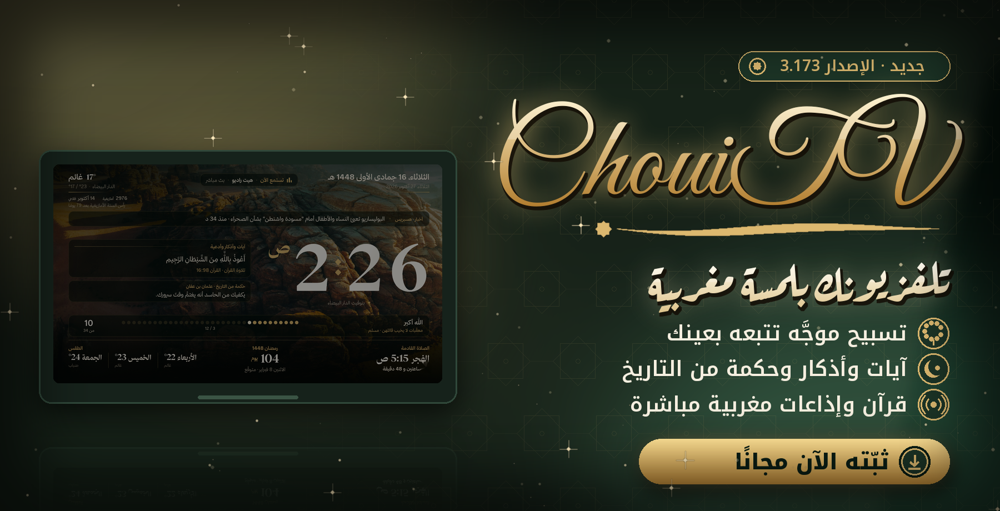</a></p>

<p align="center">
<a href="README.md">🇲🇦 العربية</a> &nbsp;·&nbsp; <a href="README.fr.md">🇫🇷 Français</a> &nbsp;·&nbsp; <b>🇬🇧 English</b>
</p>

<p align="center">
<a href="https://github.com/EMCHOUIT/ChouiTV/releases/latest"></a>

<a href="LICENSE"></a>

</p>

<p align="center">
<b>🌙 A screensaver that whispers dhikr · 📿 A tasbih you follow with your eyes · 🇲🇦 The soul of Morocco in every detail</b>
</p>

<p align="center">
<a href="#new">🆕 What's new</a> ·
<a href="#intro">✨ Why</a> ·
<a href="#gallery">🖼️ Gallery</a> ·
<a href="#home">🏠 Home</a> ·
<a href="#saver">🌙 Screensaver</a> ·
<a href="#tasbih">📿 Tasbih</a> ·
<a href="#listen">🎧 Listen</a> ·
<a href="#channels">📡 Channels</a> ·
<a href="#settings">⚙️ Settings</a> ·
<a href="#install">🚀 Install</a> ·
<a href="#faq">❓ FAQ</a> ·
<a href="#thanks">💚 Credits</a>
</p>

<p align="center">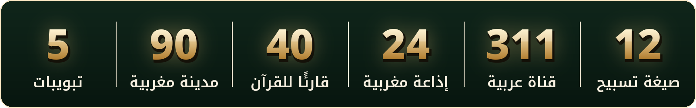</p>

<a id="new"></a>

## 🆕 What's new in 3.175

> This release gathers **everything added since 3.173**.

<table>
<tr>
<td width="50%" valign="top">

### 📻 Radios from several countries
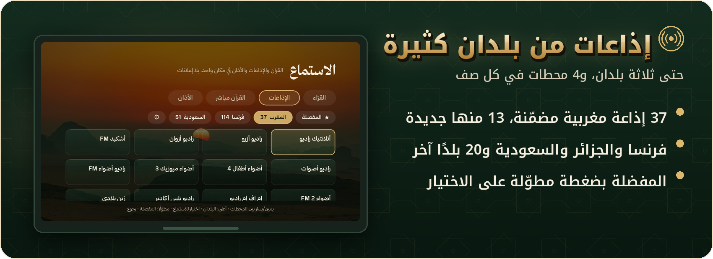

- 🌍 **Up to 3 countries**, shown as chips, **4 stations a row**
- 🇲🇦 **37 Moroccan radios** built in (13 new)
- 🛰️ France, Algeria, Saudi Arabia and 20 other countries, downloaded on request
- ⭐ **Favourites** with a long press on OK

</td>
<td width="50%" valign="top">

### ✅ Choose your countries, update
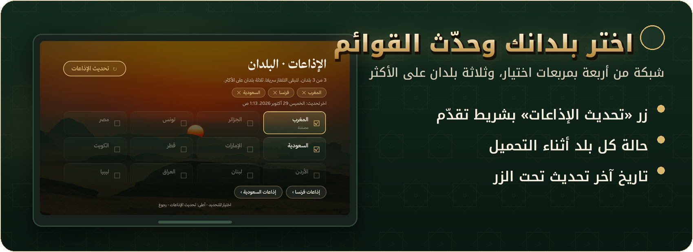

- 🔲 A grid of **four** with tick boxes
- 🔄 **«تحديث الإذاعات»** button with a **progress bar**
- 🧭 The state of **each country** while it loads
- 🗓️ The **date of the last update** under it

</td>
</tr>
<tr>
<td valign="top">

### ⏹️ A radio stops
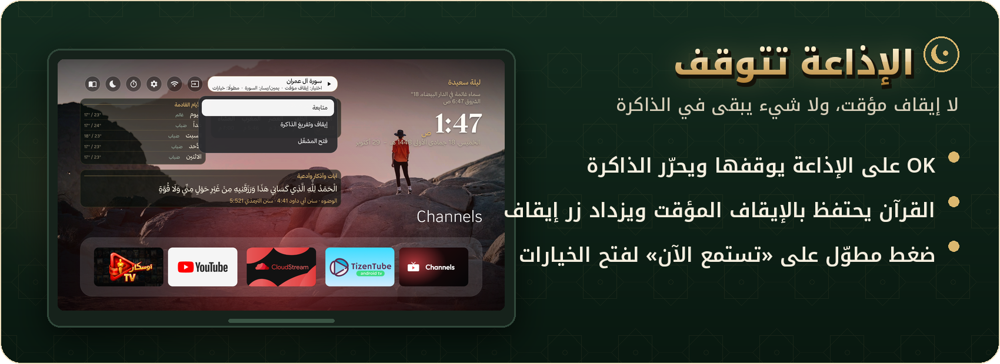

- 🛑 OK **stops** the radio and frees the memory (no pause)
- ⏸️ A recitation keeps its **pause** and gains a **stop**
- 🎛️ Long press on the **«Now playing»** card: pause, stop, the player
- 🧹 The **«المهام»** button is no longer on the home screen

</td>
<td valign="top">

### 💾 Settings include the radios
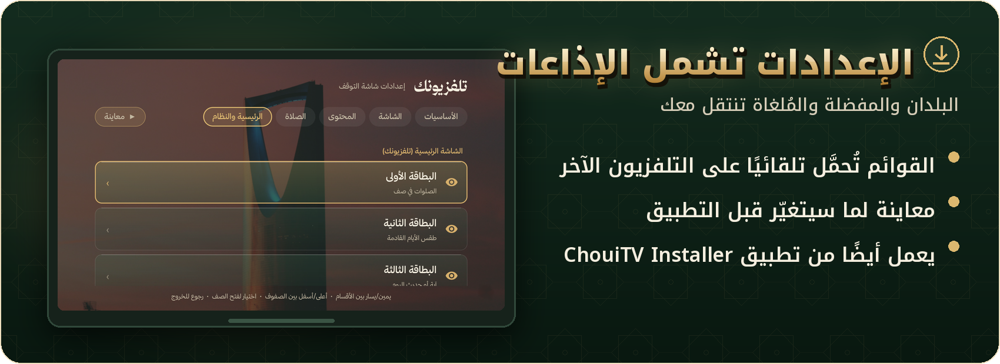

- 📤 Countries, stations left out and favourites in the file
- 📥 The lists **download again by themselves** on the other TV
- 📱 Works with **ChouiTV Installer** too

</td>
</tr>
</table>

**🧾 Also since 3.173:** settings backup · adhan per prayer · reciters in a grid · signature with build date.

**📡 Also since 3.165:** **Channels** app (**311** Arabic channels) · **time zone** and prayer **calculation method** settings · optional **cleanup** step · packages renamed `ma.chouitv.*` with a migration script · **Thmanyah** font.

<a id="intro"></a>

## ✨ Why ChouiTV?

Your TV spends hours waiting. **ChouiTV** turns that waiting into **remembrance, knowledge and family warmth**: a verse to read, a wisdom to ponder, a tasbih that flows through the house without anyone touching the remote. Polished line by line to suit a Moroccan home.

<table>
<tr>
<td width="33%" align="center">📿<br><b>Guided tasbih</b><br><sub>12 formulas with their merit and source, a bead string that lights up bead by bead</sub></td>
<td width="33%" align="center">📖<br><b>Verses and invocations</b><br><sub>A verse, a supplication or a hadith refreshed every two minutes</sub></td>
<td width="33%" align="center">🏛️<br><b>Wisdom from history</b><br><sub>Full sayings of great figures, never cut short</sub></td>
</tr>
<tr>
<td align="center">🇲🇦<br><b>Moroccan touch</b><br><sub>Weather for your family, Amazigh calendar, occasions, Atlas Lions</sub></td>
<td align="center">🎧<br><b>Quran and radios</b><br><sub>40 reciters, 37 Moroccan radios and up to 3 countries of your choice, the Quran live</sub></td>
<td align="center">📡<br><b>311 Arabic channels</b><br><sub>Moroccan and Arab channels live, sorted into groups</sub></td>
</tr>
</table>

> [!TIP]
> ✅ **No ads, no accounts** · ✅ **Arabic, right to left** · ✅ **Updates itself** from the project's releases, with a single press of OK.

<p align="center"><a href="#install"></a></p>


<a id="gallery"></a>

## 🖼️ Gallery

<sub>📸 All images come from a real TV, with the city set to **Casablanca**.</sub>

<table>
<tr>
<td width="50%">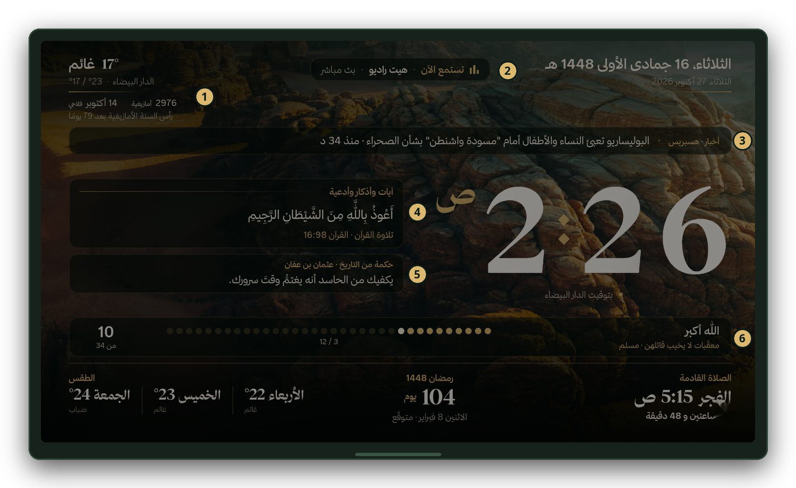<br>🌙 <sub>Screensaver: dhikr, wisdom, news, tasbih</sub></td>
<td width="50%">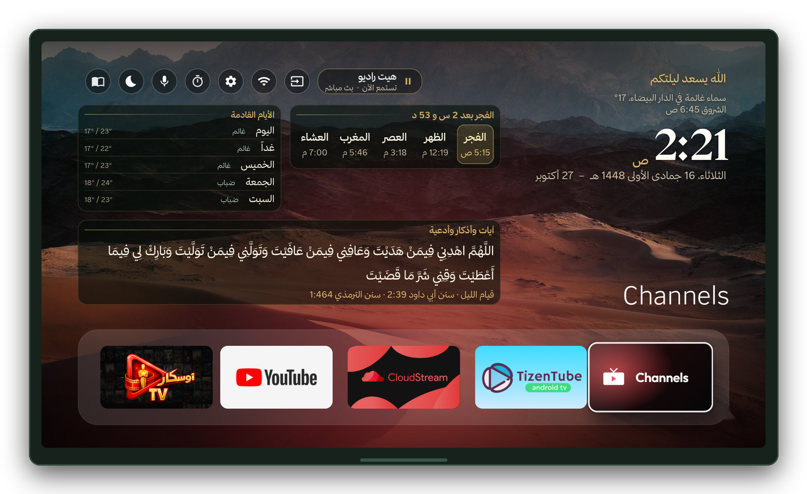<br>🏠 <sub>Home screen and the «Now playing» card</sub></td>
</tr>
<tr>
<td>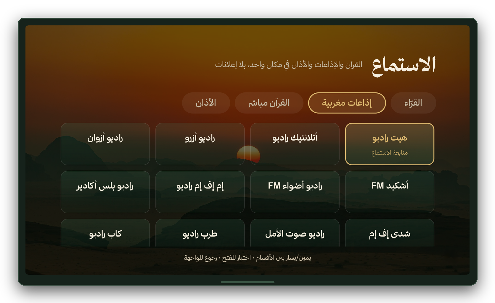<br>📻 <sub>Radios: the countries as chips, 4 stations a row</sub></td>
<td>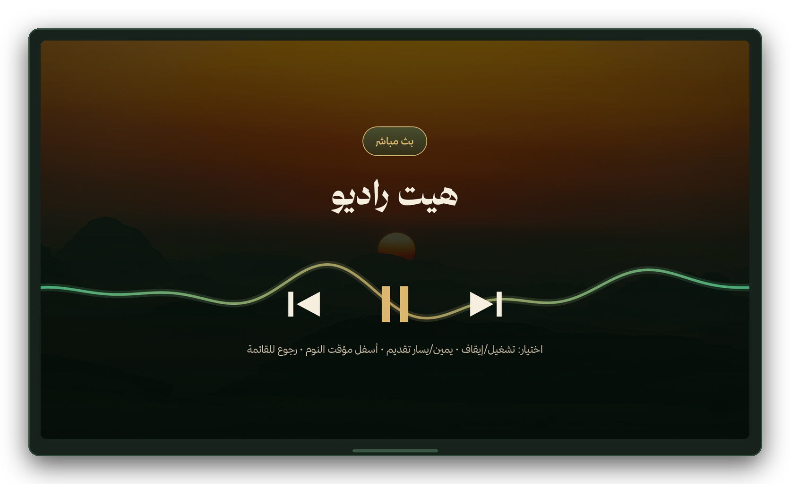<br>〰️ <sub>Player and a transparent oscilloscope in the app's colours</sub></td>
</tr>
<tr>
<td>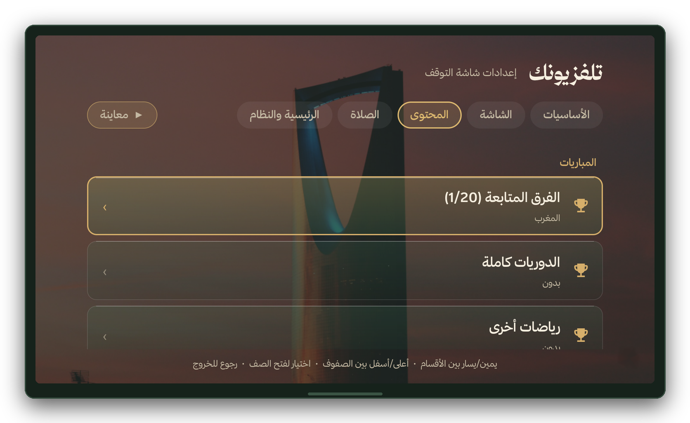<br>⚙️ <sub>Settings: «Content» tab</sub></td>
<td>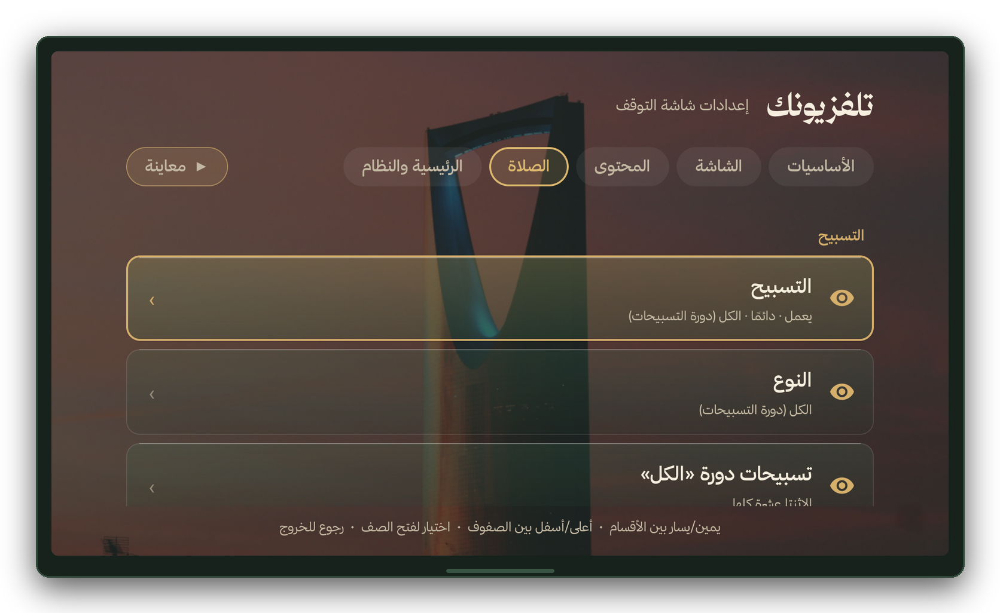<br>📿 <sub>Settings: «Prayer» tab and the «Tasbih» section</sub></td>
</tr>
</table>


<a id="home"></a>

## 🏠 The home screen


| | |
|:-:|---|
| 🔘 | **Button bar** at the top, and the **«Now playing»** card whenever a Quran recitation or radio plays (OK: pause/play for a recitation, stop for a radio; a long press: pause, stop and free the memory, or the player). |
| 👋 | **Greeting in Darija** by the time of day, with the weather, prayer times and the days ahead. |
| 🗂️ | **Up to three cards** beside the clock, your choice: prayer times, a verse or hadith, the wisdom of the day, dhikr, matches… |
| ⭐ | **Dock** for your favourite apps, reordered with the arrow keys. |


<a id="saver"></a>

## 🌙 The screensaver

It starts by itself when the TV rests, and fills the house with **calm**:


| | Item | What it does |
|:-:|---|---|
| ① 🇲🇦 | **Moroccan touch** | Rotates every 12 s: 🌤️ **weather for your family's cities** (up to four) · 🗓️ **Amazigh and farming calendar** · 🎉 **countdown to Moroccan occasions** · ⚽ **Atlas Lions** (next match and last score) · 📈 markets (optional). |
| ② 🎧 | **Now playing** | Shows when a Quran recitation or radio plays. |
| ③ 📰 | **News** | A headline from **Hespress**, **Hesport** or **Sky News Arabia**, with the category and refresh you choose (optional). |
| ④ 📖 | **Verses, dhikr, supplications** | A verse, supplication or hadith every two minutes, working offline from a built-in list. |
| ⑤ 🏛️ | **Wisdom from history** | A **complete** saying of a historical figure from Wikiquote, never cut. Offline, a ready set of Moroccan, Arab and Islamic proverbs and wisdom. |
| ⑥ 📿 | **Guided tasbih** | [Explained below 👇](#tasbih) |

<p align="center">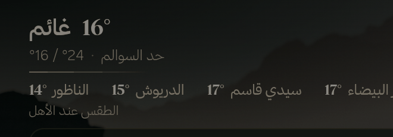<br><sub>🇲🇦 The «Moroccan touch» in rotation</sub></p>

**📍 Card positions:** every new card has a «Position» row in the settings:

| Letter | Position |
|:-:|---|
| 🅰️ | Above the verse card |
| 🅱️ | Below the verse card |
| 🇩 | Full-width strip, top centre |
| 🇪 | Full-width strip, bottom centre |

🧠 **Smart with space:** when the screen is tight, the least important cards hide themselves (B, then A, D, E), so nothing overlaps or leaves the screen.


<a id="tasbih"></a>

## 📿 The guided tasbih

**The feature the whole family will love:** a tasbih that **counts by itself** in the bottom bar. You follow it with your eyes and say it aloud, **without touching the remote**.

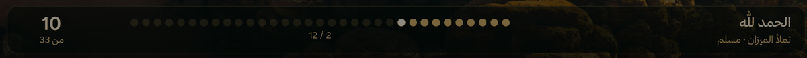

✨ In the bar: the **formula** with its **merit and source**, a **bead string** whose beads light up one by one (for a hundred: a ring of ten beads filled ten times) and the **counter** («19 of 33»). At the end of the cycle: **«Taqabbala Allah» 🤲**.

| # | Formula | 🔢 Count | ⏱️ Pace | 🌟 Merit and source |
|:-:|---|:-:|:-:|---|
| 1 | سبحان الله | 33 | 3 s | Fills what lies between heaven and earth · Muslim |
| 2 | الحمد لله | 33 | 3 s | Fills the scale · Muslim |
| 3 | الله أكبر | 34 | 3 s | Words whose sayer is never disappointed · Muslim |
| 4 | سبحان الله وبحمده | 100 | 3.5 s | Sins wiped away, even if like the foam of the sea · Bukhari and Muslim |
| 5 | سبحان الله وبحمده، سبحان الله العظيم | 33 | 5 s | Light on the tongue, heavy on the scale · Bukhari and Muslim |
| 6 | لا حول ولا قوة إلا بالله | 33 | 4 s | A treasure of Paradise · Bukhari and Muslim |
| 7 | أستغفر الله | 100 | 2.5 s | Seeking forgiveness a hundred times a day · Muslim |
| 8 | ربِّ اغفر لي وتب عليّ إنك أنت التواب الرحيم | 100 | 6.5 s | A hundred times in a single sitting · Abu Dawud and Tirmidhi |
| 9 | اللهم صلِّ وسلِّم على نبينا محمد | 100 | 4 s | Whoever prays once upon me, God prays ten times upon them · Muslim |
| 10 | لا إله إلا الله | 100 | 3.5 s | The best remembrance · Tirmidhi |
| 11 | لا إله إلا الله وحده لا شريك له… | 10 | 8 s | A hundred good deeds, and a hundred bad ones erased · Bukhari and Muslim |
| 12 | سبحان الله وبحمده عدد خلقه… | 3 | 9 s | Hadith of Juwayriyya · Muslim |

> [!WARNING]
> The merits and references are given as a reminder: please check them before relying on them for a religious ruling or for teaching.

🎛️ **You control everything** («Prayer» tab → «Tasbih»): the type (**All**, post-prayer dhikr 33·33·34, or a single formula) · the count · the pace (automatic by phrase length, fast, slow, or fixed from 1 to 10 s) · the timing (**always**, **after prayer** or **every hour**) · display time · pause · showing the merit · counter style (beads or ring) · animation · position.


<a id="listen"></a>

## 🎧 Listen: Quran, radios and adhan

One screen for everything heard at home: **🎙️ Reciters · 📻 Radios · 🕋 Live Quran · 🕌 Adhan**.

<table>
<tr>
<td width="50%">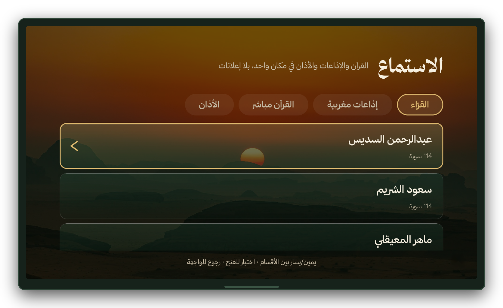<br>🎙️ <sub><b>Reciters:</b> forty reciters, complete surahs.</sub></td>
<td width="50%"><br>📻 <sub><b>Radios:</b> 37 Moroccan radios (Hit Radio, Medina FM, Med Radio, Chada FM…) and, if you like, up to <b>3 countries</b>, 4 stations a row. A long press: ★ favourite. A radio <b>stops</b> instead of pausing.</sub></td>
</tr>
<tr>
<td>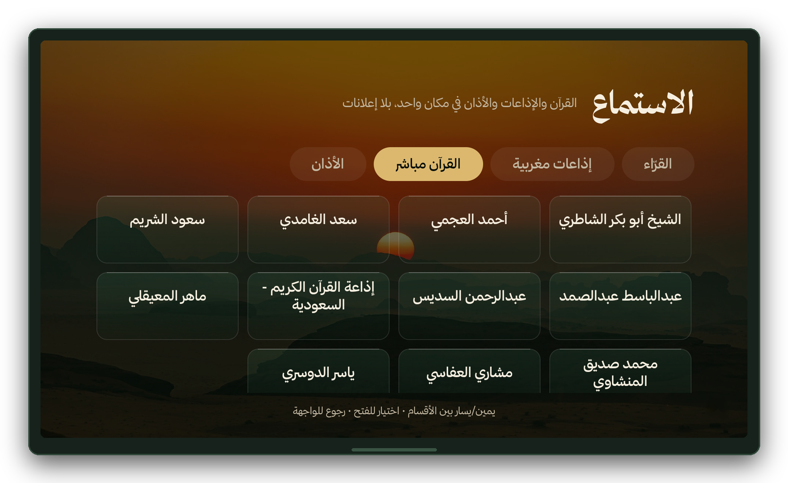<br>🕋 <sub><b>Live Quran:</b> Quran radios with the voices of great reciters.</sub></td>
<td>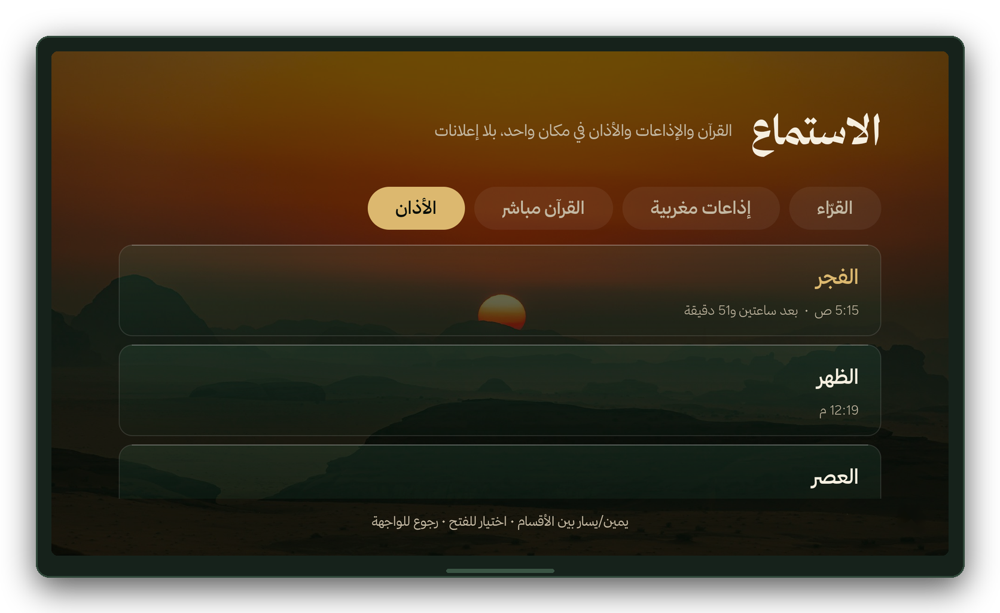<br>🕌 <sub><b>Adhan:</b> today's times, and the automatic adhan with one of 21 voices.</sub></td>
</tr>
<tr>
<td colspan="2">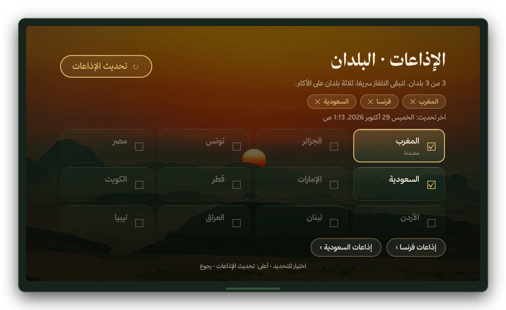<br>🌍 <sub><b>Choosing the countries:</b> three at most (23 offered; Morocco is built into the app), tick boxes, and the «تحديث الإذاعات» button with its progress bar, the state of each country and the date of the last update. The lists (https streams that were tested, adult content left out) are downloaded on request, never in the background.</sub></td>
</tr>
</table>

### 〰️ Player and oscilloscope


- 〰️ **Oscilloscope:** a transparent line with a green and gold gradient that dances during playback. By default it is a **simulated wave**, because reading the real sound on Android needs the microphone permission, which the app never asks for on screen. For the **real** wave:

  ```bash
  adb shell pm grant ma.chouitv.home android.permission.RECORD_AUDIO
  ```

- ⏲️ **Sleep timer:** down arrow: 30, 60 or 90 minutes, turn the timer off, or stop now; the chosen option has a gold frame.

<p align="center">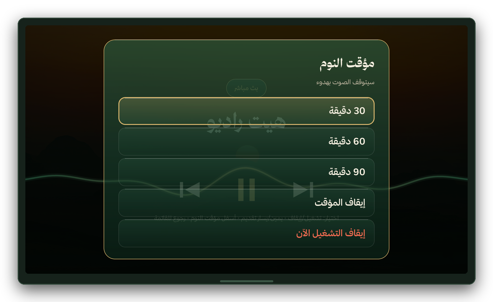</p>


<a id="channels"></a>

## 📡 Channels: 311 Arabic channels

<p align="center">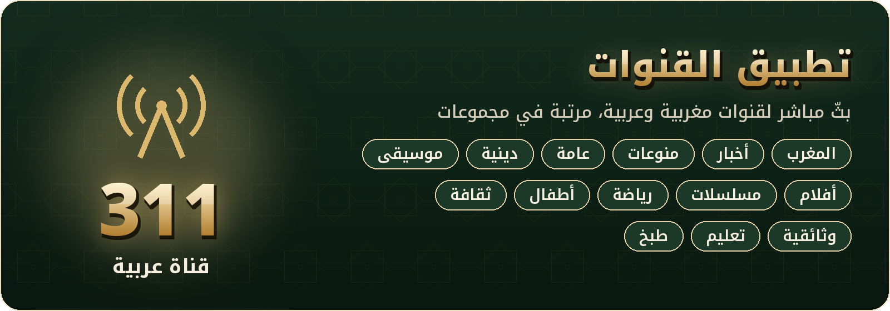</p>

The **Channels** app sits beside ChouiTV in the dock and shows **live** Moroccan and Arab channels:

| | |
|:-:|---|
| 🇲🇦 | **Morocco first**, then news, entertainment, religion, music, films, series, sport, kids, culture, documentaries, education, cooking… |
| ✅ | **311 channels**: 35 from the original list, and **276 added after testing each one** (downloading a real segment of its stream) from the open [iptv-org](https://github.com/iptv-org/iptv) library. |
| 🔄 | The list **refreshes every day** from iptv-org, by each channel's identifier. |
| 📁 | Full list in [`channels/channels.m3u`](channels/channels.m3u). |
| ⚙️ | **Installed automatically** by the setup (`optimize/install.sh channels`) with the full list, replacing any old 35-channel version. |

<sub>📺 The app comes from majnioui's [CleanXiaomiTV](https://github.com/majnioui/CleanXiaomiTV) project, with our extended list. Some channels may stutter depending on your connection speed.</sub>


<a id="settings"></a>

## ⚙️ Settings in five tabs

🧭 Always open on **«Basics»** · ↔️ **Left/right** switches tab from any row · ↕️ **Up/down** moves between rows · 🆗 **OK** opens the choice · ▶️ a permanent **«Preview»** button.

<table>
<tr>
<td width="50%">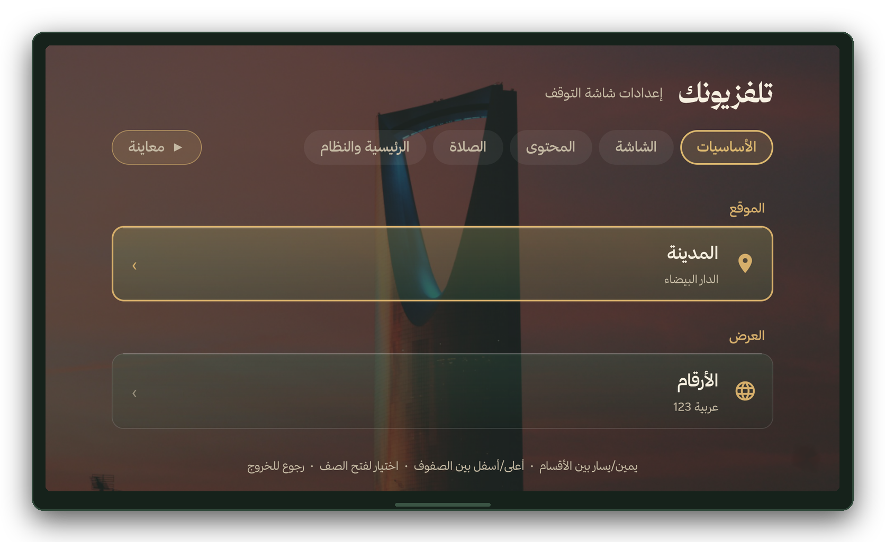<br>📍 <sub><b>Basics:</b> the city (90 Moroccan cities by region, search, or «my location»), digits, screensaver start.</sub></td>
<td width="50%">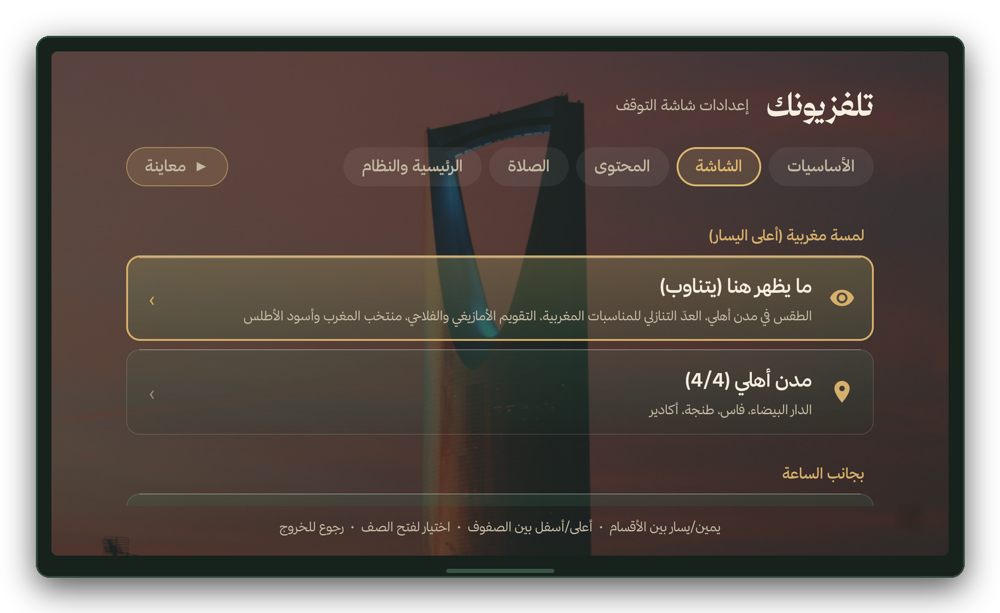<br>🖥️ <sub><b>Screen:</b> Moroccan touch and family cities, beside the clock, slots and occasions, photos.</sub></td>
</tr>
<tr>
<td><br>📰 <sub><b>Content:</b> teams (the national team and league clubs) and leagues, news, wisdom from history.</sub></td>
<td><br>🕌 <sub><b>Prayer:</b> alert before the adhan, prayer time adjustment, and tasbih. «Basics» holds the <b>time zone</b> and the <b>calculation method</b> (followed automatically: Morocco → Ministry of Awqaf).</sub></td>
</tr>
<tr>
<td colspan="2">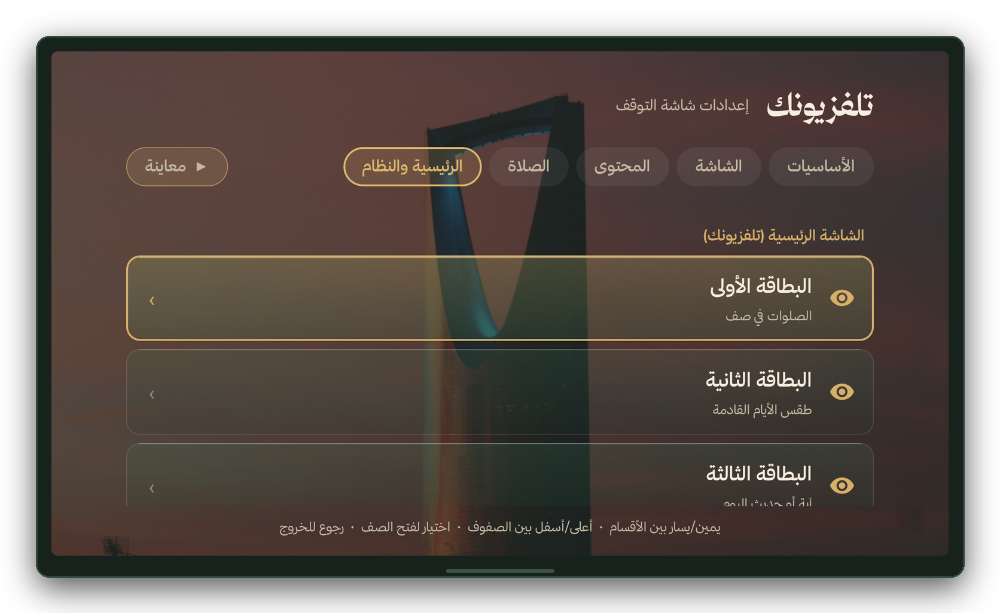<br>🏠 <sub><b>Home and system:</b> home screen cards, greeting, app order, automatic update, version number, and the settings backup.</sub></td>
</tr>
</table>


<a id="install"></a>

## 🚀 Install

<p align="center">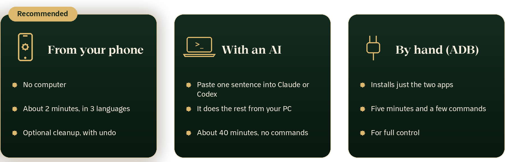</p>

> [!NOTE]
> 📺 **Works on Android TV and Google TV sets** (tested on a Xiaomi TV running Android 11). Both apps come from the [ChouiTV releases](https://github.com/EMCHOUIT/ChouiTV/releases/latest), and updates arrive with a press of **OK**.

There are **three ways** to install ChouiTV. The simplest goes through your phone, and it has its own repository: [**ChouiTV Installer**](https://github.com/EMCHOUIT/ChouiTV-Installer).

| | Option | For whom | Time |
|---|---|---|---|
| 📱 | [**Option 1: from your phone**](#install-phone) ⭐ | everyone, no computer | about 2 minutes |
| 🤖 | [**Option 2: with an AI**](#install-ai) | you have a computer and an assistant | about 40 minutes, no commands |
| 🛠️ | [**Option 3: by hand with ADB**](#install-adb) | you want full control | five minutes and a few commands |

<a id="install-phone"></a>

### 📱 Option 1: from your phone, no computer ⭐ recommended

Go to the **[ChouiTV Installer](https://github.com/EMCHOUIT/ChouiTV-Installer)** repository and download the app on an Android phone. It:

- finds your TV on the Wi-Fi, always downloads the **latest version** of ChouiTV, installs and sets it up in about two minutes;
- **guides you step by step** (or lets you choose yourself) and speaks **Arabic, French and English**, with a progress bar and a safety net if the home screen does not open;
- offers an optional **TV cleanup** with one box per app: you see the list first, you choose, and you can put everything back;
- **copies one TV's settings to another**, now or later;
- asks for no account and shows no ads.

<p align="center"><a href="https://github.com/EMCHOUIT/ChouiTV-Installer/releases/download/v1.3/ChouiTV-Installer-1.3.apk"></a></p>

[Details, screenshots and FAQ](https://github.com/EMCHOUIT/ChouiTV-Installer)

<a id="install-ai"></a>

### 🤖 Option 2: from a computer, with an AI

<p align="center">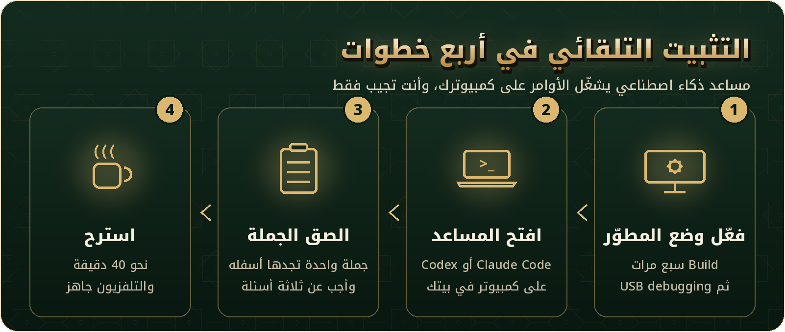</p>

**1️⃣ On the TV:** Settings → System → About → press **OK** on **Build** seven times → go back → **Developer options** → turn on **USB debugging** (and **Network debugging** if present).

**2️⃣ On a computer on the same Wi-Fi**, open an assistant that can run commands on it:

| | 🟠 Claude Code | 🟢 Codex |
|---|---|---|
| **Account** | **Claude Pro** subscription or higher | **ChatGPT** account |
| **Where** | Claude app → **Code** tab → **local** folder | Codex app |
| **Approvals** | **Allow** for the whole task | **«Approve for me»** |

<details>
<summary>🪟 <b>On Windows? Prepare the computer first</b> (three lines in PowerShell)</summary>

```powershell
winget install -e --id Git.Git --source winget
winget install -e --id Python.Python.3.12 --source winget
irm https://claude.ai/install.ps1 | iex
```

Then close PowerShell and open a new window.
</details>

**3️⃣ Paste this sentence** into the assistant, as is:

```text
ركّب تلفزيوني بـ ChouiTV من https://github.com/EMCHOUIT/ChouiTV: انسخ المستودع واتبع docs/SETUP-PROMPT.md خطوة بخطوة. أنت على كمبيوتر متصل بنفس شبكة الواي فاي ديال التلفزيون.
```

> [!TIP]
> You can also write it in your own language: *"Install ChouiTV on my TV from https://github.com/EMCHOUIT/ChouiTV: clone the repository and follow docs/SETUP-PROMPT.md step by step. You are on a computer connected to the same Wi-Fi as the TV."*

**4️⃣ Answer and relax ☕** The assistant asks three questions (approvals, **your city**, **your teams**), the TV asks you to **Allow** once, then it runs by itself for about **40 minutes**, with a few restarts.


<a id="install-adb"></a>

### 🛠️ Option 3: by hand with ADB

<p align="center">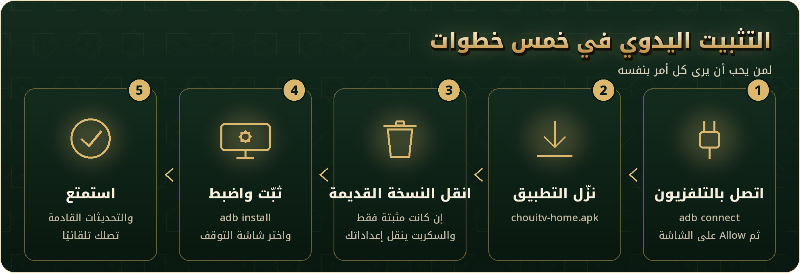</p>

<details>
<summary>🔌 <b>1. Connect to the TV</b></summary>

Turn on **USB debugging** as in option 2, install the [ADB tools](https://developer.android.com/tools/releases/platform-tools), then:

```bash
adb connect <tv-address>:5555
```

and press **Allow** on the TV screen.
</details>

<details>
<summary>⬇️ <b>2. Download the app</b></summary>

Since 4.0 ChouiTV is **one app**:

- [`chouitv-home.apk`](https://github.com/EMCHOUIT/ChouiTV/releases/latest/download/chouitv-home.apk): the home screen, the listening screens, the screensaver and the settings.
</details>

<details>
<summary>🔁 <b>3. Have the old version? Move it over</b></summary>

Until 3.x there were two apps (`ma.chouitv.home` and `ma.chouitv.screensaver`); 4.0 is one. The home app updates in place; the second app is not shipped any more, so the script saves its settings, installs 4.0, carries the settings over and, only after checking, removes the old screensaver app (it asks first; `--yes` skips the question):

```bash
optimize/migrate-to-v4.sh                # a 3.x TV: this TV's own settings
optimize/migrate-to-v4.sh settings.json   # or from another TV's export file
```

The photos «صوري» and the tasks live in the old app's storage and are not carried over (`optimize/photos.sh` adds the photos again). A TV still on the very old names (`sa.urtv.*`) uses `optimize/migrate-to-chouitv.sh`, which goes straight to 4.0.

</details>

<details>
<summary>📺 <b>4. Install and set up</b></summary>

```bash
adb install -r chouitv-home.apk
adb shell settings put secure screensaver_enabled 1
adb shell settings put secure screensaver_components ma.chouitv.home/ma.chouitv.screensaver.ScreenDream
adb shell settings put secure screensaver_default_component ma.chouitv.home/ma.chouitv.screensaver.ScreenDream
```

Then press **Home** and choose the new launcher if the TV asks. (Some TVs keep the manufacturer's launcher: option 2, or the project scripts below, handle that safely.)
</details>

<details>
<summary>✅ <b>5. Enjoy</b></summary>

Open Settings → **«Basics»** → **City**, and try the **«▶ Preview»** button. Future updates arrive on their own.
</details>

<details>
<summary>🧰 <b>For the experienced: everything with the project scripts</b></summary>

```bash
git clone --depth 1 https://github.com/EMCHOUIT/ChouiTV
cd ChouiTV
optimize/setup.sh          # prepares Python and the tools
optimize/find-tv.sh        # finds the TV on the network
optimize/install.sh all    # downloads the latest release, installs and sets up the app (launcher and screensaver)
```

Note: **cleaning the TV** (removing tracking, ads and trial apps) is an important step for better performance: it frees 85 to 215 MB of memory. The assistant asks before starting: if you agree it cleans, if you decline it installs only what our apps need (`SKIP_CLEANUP=1`), and you can ask for the cleanup later. From your phone, [ChouiTV Installer](https://github.com/EMCHOUIT/ChouiTV-Installer) offers the same cleanup as an option: it shows the plan first, turns off only what you choose and lets you undo everything.

To go back to how the TV was: `optimize/reset.sh`. All the details are in [`docs/SETUP-PROMPT.md`](docs/SETUP-PROMPT.md).
</details>

<details>
<summary>📡 <b>Channels app (optional)</b></summary>

The app comes from [CleanXiaomiTV](https://github.com/majnioui/CleanXiaomiTV) (the `channels` module). Automatic install: `optimize/install.sh channels` (downloads the ready build from the `channels` release). To build it yourself, the script downloads the original source and drops in [`channels.m3u`](channels/channels.m3u) and [`ChannelList.java`](channels/ChannelList.java) (discarding any cached copy with other channels):

```bash
channels/build-channels.sh        # result: channels/out/channels-release.apk
adb install -r channels/out/channels-release.apk
```
</details>

<p align="center"><a href="https://github.com/EMCHOUIT/ChouiTV/releases/latest"></a></p>


<a id="faq"></a>

## ❓ FAQ

<details><summary>🙈 <b>Why is a card not showing?</b></summary>

When the screen is tight, the least important ones hide (B, then A, D, E). Turn a card off, change its position, or set the wisdom text to «one line».
</details>

<details><summary>📍 <b>How do I change the city?</b></summary>

Settings → Basics → City: Moroccan cities sorted by the twelve regions, search, or «my location».
</details>

<details><summary>🌐 <b>Does it need internet?</b></summary>

For news and weather, yes. Verses and «wisdom from history» work offline from the built-in lists.
</details>

<details><summary>🕌 <b>Which prayer times?</b></summary>

They are calculated for your city, and you can adjust each prayer in minutes from −20 to +20.
</details>

<details><summary>↩️ <b>How do I put everything back?</b></summary>

`optimize/reset.sh`, or remove the app and re-enable the manufacturer's launcher in the TV settings.
</details>


<a id="thanks"></a>

## 💚 Sources, thanks and license

### 🔗 Data sources

📖 [alquran.cloud](https://alquran.cloud) and [ummahapi](https://ummahapi.com) · 📡 [iptv-org](https://github.com/iptv-org/iptv) and the Channels app from [CleanXiaomiTV](https://github.com/majnioui/CleanXiaomiTV) · 🏛️ Wikiquote (Wikimedia) · 📰 Hespress, Hesport and Sky News Arabia · 🌤️ [Open-Meteo](https://open-meteo.com) · ⚽ [TheSportsDB](https://www.thesportsdb.com) · 🎙️ [mp3quran.net](https://mp3quran.net) and [qurango.net](https://qurango.net) · 📻 public Moroccan radios.

### 📜 License

My code and additions are under the **MIT license** in [`LICENSE`](LICENSE) (EMChouit). The projects and sources I drew on, with their licenses, are in [`THIRD_PARTY_NOTICES.md`](THIRD_PARTY_NOTICES.md).

<p align="center"><br>⭐ <b>Like ChouiTV? Star the repository and share it with the people you love</b> ⭐<br><br><sub>Made with love in Morocco 🇲🇦 · developed by <b>EMChouit</b></sub></p>
