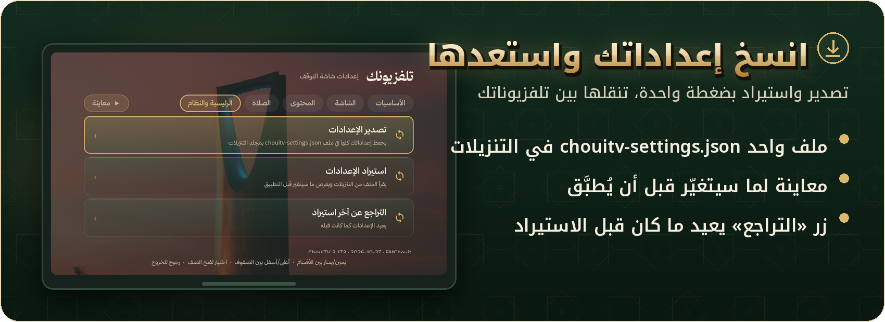
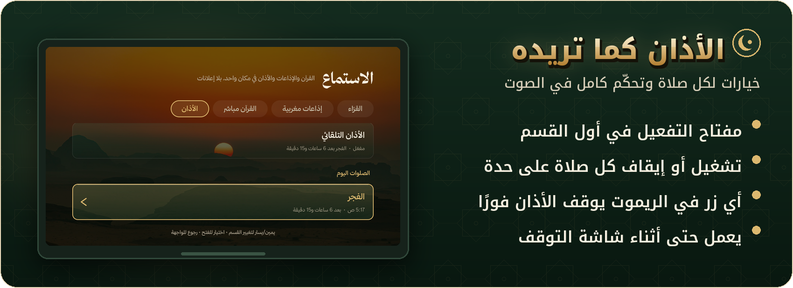
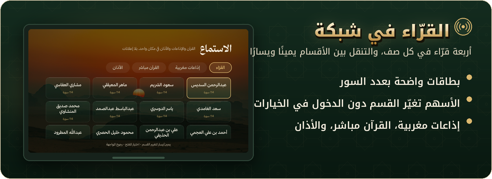
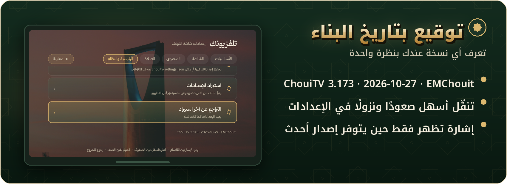
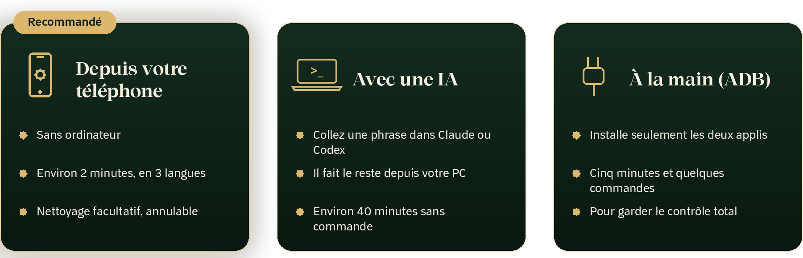

<p align="center"><a href="#install"></a></p>

<p align="center">
<a href="README.md">🇲🇦 العربية</a> &nbsp;·&nbsp; <b>🇫🇷 Français</b> &nbsp;·&nbsp; <a href="README.en.md">🇬🇧 English</a>
</p>

<p align="center">
<a href="https://github.com/EMCHOUIT/ChouiTV/releases/latest"></a>

<a href="LICENSE"></a>

</p>

<p align="center">
<b>🌙 Un économiseur d'écran qui murmure le dhikr · 📿 Un tasbih que l'on suit des yeux · 🇲🇦 L'âme du Maroc dans chaque détail</b>
</p>

<p align="center">
<a href="#new">🆕 Nouveautés</a> ·
<a href="#intro">✨ Pourquoi</a> ·
<a href="#gallery">🖼️ Galerie</a> ·
<a href="#home">🏠 Accueil</a> ·
<a href="#saver">🌙 Écran de veille</a> ·
<a href="#tasbih">📿 Tasbih</a> ·
<a href="#listen">🎧 Écoute</a> ·
<a href="#channels">📡 Chaînes</a> ·
<a href="#settings">⚙️ Réglages</a> ·
<a href="#install">🚀 Installation</a> ·
<a href="#faq">❓ FAQ</a> ·
<a href="#thanks">💚 Crédits</a>
</p>

<p align="center"></p>

<a id="new"></a>

## 🆕 Nouveautés de la 3.173

> Cette version réunit **tout ce qui a été ajouté depuis la 3.165**.

<table>
<tr>
<td width="50%" valign="top">

### 💾 Sauvegarde des réglages


- 📤 **Exporter** : un fichier `chouitv-settings.json` dans Téléchargements
- 📥 **Importer** : l'écran montre **ce qui va changer** avant d'appliquer
- ↩️ **Annuler** le dernier import
- 🚚 Idéal pour passer d'une TV à l'autre

</td>
<td width="50%" valign="top">

### 🕌 L'adhan comme vous le voulez


- 🔘 Interrupteur de l'**adhan automatique** en haut de l'onglet
- 🕋 **Chaque prière** s'active ou se coupe séparément
- 🔕 **N'importe quelle touche** de la télécommande l'arrête, même en veille
- 🇲🇦 Méthode du **ministère des Habous**, fuseau GMT

</td>
</tr>
<tr>
<td valign="top">

### 🎙️ Récitants en grille


- 🧱 **Quatre récitants par ligne**, avec le nombre de sourates
- ↔️ **Gauche/droite** change de section : Récitants, Radios marocaines, Coran en direct, Adhan

</td>
<td valign="top">

### 🏷️ Signature avec date de build


- 🧾 `ChouiTV 3.173 · 2026-10-27 · EMChouit` en bas des réglages
- 🔔 « Version plus récente » n'apparaît que s'il y en a une
- 🧭 Navigation haut/bas corrigée dans « Principal et système »

</td>
</tr>
</table>

**📡 Et aussi depuis la 3.165 :** application **Channels** (**311 chaînes** arabes) · réglage du **fuseau horaire** et de la **méthode de calcul** · étape de **nettoyage** facultative · paquets renommés `ma.chouitv.*` avec script de migration · police **Thmanyah**.

<a id="intro"></a>

## ✨ Pourquoi ChouiTV ?

Votre télé passe des heures à attendre. **ChouiTV** transforme cette attente en **dhikr, savoir et chaleur familiale** : un verset qui se lit, une sagesse qui se médite, un tasbih qui s'égrène dans la maison sans que personne touche la télécommande. Peaufiné ligne par ligne pour un foyer marocain.

<table>
<tr>
<td width="33%" align="center">📿<br><b>Tasbih guidé</b><br><sub>12 formules avec leur mérite et leur source, un chapelet qui s'illumine grain par grain</sub></td>
<td width="33%" align="center">📖<br><b>Versets et invocations</b><br><sub>Un verset, une invocation ou un hadith renouvelé toutes les deux minutes</sub></td>
<td width="33%" align="center">🏛️<br><b>Sagesse de l'histoire</b><br><sub>Des citations complètes de grandes figures, jamais coupées</sub></td>
</tr>
<tr>
<td align="center">🇲🇦<br><b>Touche marocaine</b><br><sub>Météo des proches, calendrier amazigh, fêtes, Lions de l'Atlas</sub></td>
<td align="center">🎧<br><b>Coran et radios</b><br><sub>40 récitants, 24 radios marocaines, le Coran en direct</sub></td>
<td align="center">📡<br><b>311 chaînes arabes</b><br><sub>Chaînes marocaines et arabes en direct, classées par groupes</sub></td>
</tr>
</table>

> [!TIP]
> ✅ **Sans publicité ni compte** · ✅ **Arabe de droite à gauche** · ✅ **Se met à jour tout seul** depuis les versions du projet, d'une pression sur OK.

<p align="center"><a href="#install"></a></p>


<a id="gallery"></a>

## 🖼️ Galerie

<sub>📸 Toutes les images viennent d'une vraie télé, ville affichée : **Casablanca**.</sub>

<table>
<tr>
<td width="50%"><br>🌙 <sub>Écran de veille : dhikr, sagesse, actualités, tasbih</sub></td>
<td width="50%"><br>🏠 <sub>Accueil et carte « En écoute »</sub></td>
</tr>
<tr>
<td><br>📻 <sub>Radios marocaines en cartes, par ordre alphabétique</sub></td>
<td><br>〰️ <sub>Lecteur et oscilloscope transparent aux couleurs de l'appli</sub></td>
</tr>
<tr>
<td><br>⚙️ <sub>Réglages : onglet « Contenu »</sub></td>
<td><br>📿 <sub>Réglages : onglet « Prière » et section « Tasbih »</sub></td>
</tr>
</table>


<a id="home"></a>

## 🏠 L'écran d'accueil


| | |
|:-:|---|
| 🔘 | **Barre de boutons** en haut, et la carte **« En écoute »** dès qu'un Coran ou une radio joue (OK pour pause/lecture). |
| 👋 | **Salutation en darija** selon l'heure, avec la météo, les horaires de prière et les jours à venir. |
| 🗂️ | **Jusqu'à trois cartes** à côté de l'horloge, à votre choix : horaires de prière, verset ou hadith, sagesse du jour, dhikr, matchs… |
| ⭐ | **Dock** de vos applications favorites, réordonnables aux flèches. |


<a id="saver"></a>

## 🌙 L'écran de veille

Il démarre tout seul quand la télé se repose et remplit la maison de **sérénité** :


| | Élément | Ce qu'il fait |
|:-:|---|---|
| ① 🇲🇦 | **Touche marocaine** | Alterne toutes les 12 s : 🌤️ **météo des villes de la famille** (jusqu'à quatre) · 🗓️ **calendrier amazigh et agricole** · 🎉 **compte à rebours des fêtes marocaines** · ⚽ **Lions de l'Atlas** (prochain match et dernier score) · 📈 marchés (facultatif). |
| ② 🎧 | **En écoute** | Apparaît quand un Coran ou une radio joue. |
| ③ 📰 | **Actualités** | Un titre de **Hespress**, **Hesport** ou **Sky News Arabia**, catégorie et fréquence au choix (facultatif). |
| ④ 📖 | **Versets, dhikr, invocations** | Un verset, une invocation ou un hadith toutes les deux minutes, hors ligne grâce à une liste intégrée. |
| ⑤ 🏛️ | **Sagesse de l'histoire** | Une citation **complète** d'une figure historique (Wikiquote), jamais coupée. Hors ligne : un recueil de proverbes marocains, arabes et islamiques. |
| ⑥ 📿 | **Tasbih guidé** | [Détails plus bas 👇](#tasbih) |

<p align="center"><br><sub>🇲🇦 La « touche marocaine » en rotation</sub></p>

**📍 Emplacements des cartes :** chaque nouvelle carte a une ligne « Emplacement » dans les réglages :

| Lettre | Emplacement |
|:-:|---|
| 🅰️ | Au-dessus de la carte des versets |
| 🅱️ | Sous la carte des versets |
| 🇩 | Bandeau pleine largeur, en haut au centre |
| 🇪 | Bandeau pleine largeur, en bas au centre |

🧠 **Malin avec la place :** si l'écran est étroit, les cartes les moins importantes se masquent d'elles-mêmes (B, puis A, D, E) : rien ne se chevauche ni ne sort de l'écran.


<a id="tasbih"></a>

## 📿 Le tasbih guidé

**La fonction que toute la famille adorera :** un tasbih qui **compte tout seul** dans la barre du bas. On le suit des yeux et on le récite, **sans toucher la télécommande**.


✨ Dans la barre : la **formule** avec son **mérite et sa source**, un **chapelet** dont les grains s'allument un à un (pour cent : un tour de dix grains rempli dix fois) et le **compteur** (« 19 sur 33 »). À la fin du cycle : **« Taqabbala Llah » 🤲**.

| # | Formule | 🔢 Nombre | ⏱️ Rythme | 🌟 Mérite et source |
|:-:|---|:-:|:-:|---|
| 1 | سبحان الله | 33 | 3 s | Remplit l'espace entre le ciel et la terre · Muslim |
| 2 | الحمد لله | 33 | 3 s | Remplit la balance · Muslim |
| 3 | الله أكبر | 34 | 3 s | Paroles dont l'auteur n'est jamais déçu · Muslim |
| 4 | سبحان الله وبحمده | 100 | 3,5 s | Péchés effacés, fussent-ils comme l'écume de la mer · Bukhari et Muslim |
| 5 | سبحان الله وبحمده، سبحان الله العظيم | 33 | 5 s | Légères sur la langue, lourdes dans la balance · Bukhari et Muslim |
| 6 | لا حول ولا قوة إلا بالله | 33 | 4 s | Un trésor du Paradis · Bukhari et Muslim |
| 7 | أستغفر الله | 100 | 2,5 s | Demander pardon cent fois par jour · Muslim |
| 8 | ربِّ اغفر لي وتب عليّ إنك أنت التواب الرحيم | 100 | 6,5 s | Cent fois dans une même assemblée · Abu Dawud et Tirmidhi |
| 9 | اللهم صلِّ وسلِّم على نبينا محمد | 100 | 4 s | Qui prie une fois sur moi, Dieu prie dix fois sur lui · Muslim |
| 10 | لا إله إلا الله | 100 | 3,5 s | La meilleure invocation · Tirmidhi |
| 11 | لا إله إلا الله وحده لا شريك له… | 10 | 8 s | Cent bonnes actions et cent mauvaises effacées · Bukhari et Muslim |
| 12 | سبحان الله وبحمده عدد خلقه… | 3 | 9 s | Hadith de Juwayriya · Muslim |

> [!WARNING]
> Les mérites et références sont donnés à titre de rappel : à vérifier avant tout usage pour un avis juridique religieux ou l'enseignement.

🎛️ **Tout se règle** (onglet « Prière » → « Tasbih ») : le type (**Tout**, dhikr après la prière 33·33·34, ou une seule formule) · le nombre · le rythme (automatique selon la longueur, rapide, lent, ou fixe de 1 à 10 s) · le moment (**toujours**, **après la prière** ou **chaque heure**) · la durée d'affichage · la pause · l'affichage du mérite · la forme du compteur (grains ou anneau) · l'animation · l'emplacement.


<a id="listen"></a>

## 🎧 Écoute : Coran, radios et adhan

Un seul écran pour tout ce qui s'écoute à la maison : **🎙️ Récitants · 📻 Radios marocaines · 🕋 Coran en direct · 🕌 Adhan**.

<table>
<tr>
<td width="50%"><br>🎙️ <sub><b>Récitants :</b> quarante récitants, sourates complètes.</sub></td>
<td width="50%"><br>📻 <sub><b>Radios marocaines :</b> 24 radios (Hit Radio, Medina FM, Med Radio, Chada FM…) par ordre alphabétique.</sub></td>
</tr>
<tr>
<td><br>🕋 <sub><b>Coran en direct :</b> radios coraniques des plus grands récitants.</sub></td>
<td><br>🕌 <sub><b>Adhan :</b> horaires du jour et adhan automatique avec l'une des 21 voix.</sub></td>
</tr>
</table>

### 〰️ Lecteur et oscilloscope


- 〰️ **Oscilloscope :** un trait transparent dégradé vert et or qui danse pendant la lecture. Par défaut c'est une **onde simulée**, car lire le vrai son sur Android exige l'autorisation du micro, que l'appli ne demande jamais à l'écran. Pour l'onde **réelle** :

  ```bash
  adb shell pm grant ma.chouitv.home android.permission.RECORD_AUDIO
  ```

- ⏲️ **Minuterie de sommeil :** flèche du bas : 30, 60 ou 90 minutes, désactiver la minuterie, ou arrêter maintenant ; le choix actif est cerclé d'or.

<p align="center"></p>


<a id="channels"></a>

## 📡 Chaînes : 311 chaînes arabes

<p align="center"></p>

L'application **Channels** accompagne ChouiTV dans le dock et diffuse **en direct** des chaînes marocaines et arabes :

| | |
|:-:|---|
| 🇲🇦 | **Le Maroc d'abord**, puis actualités, divertissement, religion, musique, films, séries, sport, jeunesse, culture, documentaires, éducation, cuisine… |
| ✅ | **311 chaînes** : 35 de la liste d'origine et **276 ajoutées après test de chacune** (téléchargement d'un vrai segment de son flux) depuis la bibliothèque libre [iptv-org](https://github.com/iptv-org/iptv). |
| 🔄 | La liste **se renouvelle chaque jour** depuis iptv-org, selon l'identifiant de chaque chaîne. |
| 📁 | Liste complète : [`channels/channels.m3u`](channels/channels.m3u). |
| ⚙️ | **Installée automatiquement** par la configuration (`optimize/install.sh channels`) avec la liste complète, en remplaçant toute ancienne version à 35 chaînes. |

<sub>📺 L'application vient du projet [CleanXiaomiTV](https://github.com/majnioui/CleanXiaomiTV) de majnioui, avec notre liste élargie. Certaines chaînes peuvent saccader selon votre débit.</sub>


<a id="settings"></a>

## ⚙️ Les réglages en cinq onglets

🧭 S'ouvrent toujours sur **« Essentiel »** · ↔️ **Gauche/droite** change d'onglet depuis n'importe quelle ligne · ↕️ **Haut/bas** change de ligne · 🆗 **OK** ouvre le choix · ▶️ un bouton **« Aperçu »** toujours présent.

<table>
<tr>
<td width="50%"><br>📍 <sub><b>Essentiel :</b> la ville (90 villes marocaines par région, recherche ou « ma position »), les chiffres, le démarrage de l'écran de veille.</sub></td>
<td width="50%"><br>🖥️ <sub><b>Écran :</b> touche marocaine et villes de la famille, à côté de l'horloge, cases et fêtes, photos.</sub></td>
</tr>
<tr>
<td><br>📰 <sub><b>Contenu :</b> équipes (équipe nationale et clubs du championnat) et ligues, actualités, sagesse de l'histoire.</sub></td>
<td><br>🕌 <sub><b>Prière :</b> alerte avant l'adhan, ajustement des horaires et tasbih. « Essentiel » contient le <b>fuseau horaire</b> et la <b>méthode de calcul</b> (suivie automatiquement : Maroc → ministère des Habous).</sub></td>
</tr>
<tr>
<td colspan="2"><br>🏠 <sub><b>Accueil et système :</b> cartes de l'accueil, salutation, ordre des applications, mise à jour automatique, numéro de version, et la sauvegarde des réglages.</sub></td>
</tr>
</table>


<a id="install"></a>

## 🚀 Installation

<p align="center"></p>

> [!NOTE]
> 📺 **Fonctionne sur les télés Android TV et Google TV** (testé sur une télé Xiaomi sous Android 11). Les deux applis viennent des [versions de ChouiTV](https://github.com/EMCHOUIT/ChouiTV/releases/latest) et les mises à jour arrivent d'une pression sur **OK**.

Il y a **trois façons** d'installer ChouiTV. La plus simple passe par votre téléphone, et elle a son propre dépôt : [**ChouiTV Installer**](https://github.com/EMCHOUIT/ChouiTV-Installer).

| | Option | Pour qui | Durée |
|---|---|---|---|
| 📱 | [**Option 1 : depuis votre téléphone**](#install-phone) ⭐ | tout le monde, sans ordinateur | environ 2 minutes |
| 🤖 | [**Option 2 : avec une IA**](#install-ai) | vous avez un ordinateur et un assistant | environ 40 minutes, sans commande |
| 🛠️ | [**Option 3 : à la main avec ADB**](#install-adb) | vous voulez garder le contrôle | cinq minutes et quelques commandes |

<a id="install-phone"></a>

### 📱 Option 1 : depuis votre téléphone, sans ordinateur ⭐ recommandée

Rendez-vous sur le dépôt **[ChouiTV Installer](https://github.com/EMCHOUIT/ChouiTV-Installer)** et téléchargez l'appli sur un téléphone Android. Elle :

- trouve votre télé sur le Wi-Fi, télécharge toujours la **dernière version** de ChouiTV, l'installe et la règle en environ deux minutes ;
- **vous guide pas à pas** (ou vous laisse choisir vous-même) et parle **arabe, français et anglais**, avec une barre de progression et un filet de sécurité si l'accueil ne s'ouvre pas ;
- propose, en option, un **nettoyage de la télé** avec une case par appli : vous voyez la liste avant, vous choisissez, et vous pouvez tout remettre ;
- **copie les réglages d'une télé sur une autre**, maintenant ou plus tard ;
- ne demande ni compte, ni publicité.

<p align="center"><a href="https://github.com/EMCHOUIT/ChouiTV-Installer/releases/latest/download/ChouiTV-Installer.apk"></a></p>

[Détails, captures et FAQ](https://github.com/EMCHOUIT/ChouiTV-Installer)

<a id="install-ai"></a>

### 🤖 Option 2 : depuis un ordinateur, avec une IA

<p align="center"></p>

**1️⃣ Sur la télé :** Paramètres → Système → À propos → appuyez sept fois sur **OK** sur **Build** → retour → **Options pour les développeurs** → activez **USB debugging** (et **Network debugging** s'il existe).

**2️⃣ Sur un ordinateur du même Wi-Fi**, ouvrez un assistant qui peut y exécuter des commandes :

| | 🟠 Claude Code | 🟢 Codex |
|---|---|---|
| **Compte** | abonnement **Claude Pro** ou supérieur | compte **ChatGPT** |
| **Où** | appli Claude → onglet **Code** → dossier **local** | appli Codex |
| **Autorisations** | **Allow** pour toute la tâche | **« Approve for me »** |

<details>
<summary>🪟 <b>Sous Windows ? Préparez d'abord l'ordinateur</b> (trois lignes dans PowerShell)</summary>

```powershell
winget install -e --id Git.Git --source winget
winget install -e --id Python.Python.3.12 --source winget
irm https://claude.ai/install.ps1 | iex
```

Puis fermez PowerShell et ouvrez une nouvelle fenêtre.
</details>

**3️⃣ Collez cette phrase** dans l'assistant, telle quelle :

```text
ركّب تلفزيوني بـ ChouiTV من https://github.com/EMCHOUIT/ChouiTV: انسخ المستودع واتبع docs/SETUP-PROMPT.md خطوة بخطوة. أنت على كمبيوتر متصل بنفس شبكة الواي فاي ديال التلفزيون.
```

> [!TIP]
> Vous pouvez aussi l'écrire dans votre langue : *« Installe ChouiTV sur ma télé depuis https://github.com/EMCHOUIT/ChouiTV : clone le dépôt et suis docs/SETUP-PROMPT.md pas à pas. Tu es sur un ordinateur connecté au même Wi-Fi que la télé. »*

**4️⃣ Répondez et détendez-vous ☕** L'assistant pose trois questions (autorisations, **votre ville**, **vos équipes**), la télé demande **Allow** une fois, puis tout se fait seul en environ **40 minutes**, avec quelques redémarrages.


<a id="install-adb"></a>

### 🛠️ Option 3 : à la main avec ADB

<p align="center"></p>

<details>
<summary>🔌 <b>1. Connectez-vous à la télé</b></summary>

Activez **USB debugging** comme dans l'option 2, installez les [outils ADB](https://developer.android.com/tools/releases/platform-tools), puis :

```bash
adb connect <adresse-de-la-télé>:5555
```

et appuyez sur **Allow** sur l'écran de la télé.
</details>

<details>
<summary>⬇️ <b>2. Téléchargez les deux applis</b></summary>

- [`chouitv-home.apk`](https://github.com/EMCHOUIT/ChouiTV/releases/latest/download/chouitv-home.apk) : l'accueil et l'écoute.
- [`chouitv-screensaver.apk`](https://github.com/EMCHOUIT/ChouiTV/releases/latest/download/chouitv-screensaver.apk) : l'écran de veille et les réglages.
</details>

<details>
<summary>🔁 <b>3. Vous avez l'ancienne version ? Migrez-la</b></summary>

Les deux applis ont de nouveaux noms (`ma.chouitv.*`) : l'ancienne n'est donc pas mise à jour par-dessus. Le script reprend vos réglages, installe la nouvelle et supprime l'ancienne :

```bash
optimize/migrate-to-chouitv.sh                # les réglages de cette télé (depuis l'ancienne 3.170 ou plus récente)
optimize/migrate-to-chouitv.sh settings.json   # ou depuis un export d'une autre télé
```

</details>

<details>
<summary>📺 <b>4. Installez et réglez</b></summary>

```bash
adb install -r chouitv-screensaver.apk
adb install -r chouitv-home.apk
adb shell settings put secure screensaver_enabled 1
adb shell settings put secure screensaver_components ma.chouitv.screensaver/.ScreenDream
adb shell settings put secure screensaver_default_component ma.chouitv.screensaver/.ScreenDream
```

Puis appuyez sur **Home** et choisissez le nouvel écran d'accueil si la télé le demande. (Certaines télés gardent l'accueil du constructeur : la l'option 2, ou les scripts du projet ci-dessous, s'en chargent en toute sécurité.)
</details>

<details>
<summary>✅ <b>5. Profitez-en</b></summary>

Ouvrez Réglages → **« Essentiel »** → **Ville**, et essayez le bouton **« ▶ Aperçu »**. Les prochaines mises à jour arrivent toutes seules.
</details>

<details>
<summary>🧰 <b>Pour les initiés : tout avec les scripts du projet</b></summary>

```bash
git clone --depth 1 https://github.com/EMCHOUIT/ChouiTV
cd ChouiTV
optimize/setup.sh          # prépare Python et les outils
optimize/find-tv.sh        # trouve la télé sur le réseau
optimize/install.sh all    # télécharge la dernière version, installe l'accueil et l'écran de veille, et les règle
```

Remarque : le **nettoyage de la télé** (suppression du pistage, des publicités et des applis d'essai) est une étape importante pour de meilleures performances : il libère de 85 à 215 Mo de mémoire. L'assistant vous demande avant de commencer : si vous acceptez, il nettoie ; sinon, il installe seulement ce dont nos applis ont besoin (`SKIP_CLEANUP=1`), et vous pouvez demander le nettoyage plus tard. Depuis le téléphone, [ChouiTV Installer](https://github.com/EMCHOUIT/ChouiTV-Installer) propose le même nettoyage en option : il montre d'abord le plan, ne coupe que ce que vous choisissez et permet de tout annuler.

Pour revenir à l'état d'origine : `optimize/reset.sh`. Tous les détails dans [`docs/SETUP-PROMPT.md`](docs/SETUP-PROMPT.md).
</details>

<details>
<summary>📡 <b>Application Channels (facultative)</b></summary>

L'application vient de [CleanXiaomiTV](https://github.com/majnioui/CleanXiaomiTV) (module `channels`). Installation automatique : `optimize/install.sh channels` (télécharge la version prête depuis la release `channels`). Pour la compiler vous-même, le script télécharge la source d'origine et y place [`channels.m3u`](channels/channels.m3u) et [`ChannelList.java`](channels/ChannelList.java) (en écartant toute copie en cache avec d'autres chaînes) :

```bash
channels/build-channels.sh        # résultat : channels/out/channels-release.apk
adb install -r channels/out/channels-release.apk
```
</details>

<p align="center"><a href="https://github.com/EMCHOUIT/ChouiTV/releases/latest"></a></p>


<a id="faq"></a>

## ❓ Questions fréquentes

<details><summary>🙈 <b>Pourquoi une carte n'apparaît-elle pas ?</b></summary>

Si l'écran est étroit, les moins importantes se masquent (B, puis A, D, E). Désactivez une carte, changez son emplacement, ou mettez le texte de la sagesse sur « une seule ligne ».
</details>

<details><summary>📍 <b>Comment changer de ville ?</b></summary>

Réglages → Essentiel → Ville : les villes du Maroc classées par les douze régions, la recherche, ou « ma position ».
</details>

<details><summary>🌐 <b>Faut-il Internet ?</b></summary>

Pour les actualités et la météo, oui. Les versets et la « sagesse de l'histoire » fonctionnent hors ligne grâce aux listes intégrées.
</details>

<details><summary>🕌 <b>Quels horaires de prière ?</b></summary>

Ils sont calculés pour votre ville ; vous pouvez ajuster chaque prière en minutes, de −20 à +20.
</details>

<details><summary>↩️ <b>Comment tout remettre comme avant ?</b></summary>

`optimize/reset.sh`, ou désinstallez les deux applis puis réactivez l'accueil du constructeur dans les paramètres de la télé.
</details>


<a id="thanks"></a>

## 💚 Sources, remerciements et licence

### 🔗 Sources de données

📖 [alquran.cloud](https://alquran.cloud) et [ummahapi](https://ummahapi.com) · 📡 [iptv-org](https://github.com/iptv-org/iptv) et l'application Channels de [CleanXiaomiTV](https://github.com/majnioui/CleanXiaomiTV) · 🏛️ Wikiquote (Wikimedia) · 📰 Hespress, Hesport et Sky News Arabia · 🌤️ [Open-Meteo](https://open-meteo.com) · ⚽ [TheSportsDB](https://www.thesportsdb.com) · 🎙️ [mp3quran.net](https://mp3quran.net) et [qurango.net](https://qurango.net) · 📻 radios marocaines publiques.

### 📜 Licence

Mon code et mes ajouts sont sous **licence MIT** dans [`LICENSE`](LICENSE) (EMChouit). Les projets et sources dont je me suis servi, avec leurs licences, sont dans [`THIRD_PARTY_NOTICES.md`](THIRD_PARTY_NOTICES.md).

<p align="center"><br>⭐ <b>ChouiTV vous plaît ? Mettez une étoile au dépôt et partagez-le avec vos proches</b> ⭐<br><br><sub>Fait avec amour au Maroc 🇲🇦 · développé par <b>EMChouit</b></sub></p>
