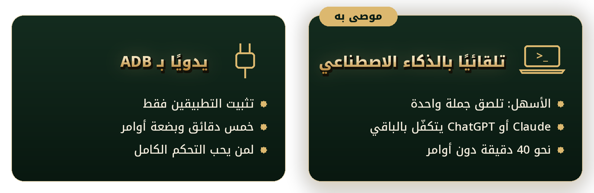

<p align="center"><a href="#install"></a></p>

<div dir="rtl" align="right">

<p align="center">
<b>🌙 شاشة توقف تنبض بالذكر · 📿 تسبيح تتبعه بعينك · 🇲🇦 روح مغربية في كل تفصيلة</b>
</p>

<p align="center">
<a href="#new">🆕 الجديد</a> ·
<a href="#intro">✨ لماذا ChouiTV</a> ·
<a href="#gallery">🖼️ الصور</a> ·
<a href="#home">🏠 الرئيسية</a> ·
<a href="#saver">🌙 شاشة التوقف</a> ·
<a href="#tasbih">📿 التسبيح</a> ·
<a href="#listen">🎧 الاستماع</a> ·
<a href="#channels">📡 القنوات</a> ·
<a href="#settings">⚙️ الإعدادات</a> ·
<a href="#install">🚀 التثبيت</a> ·
<a href="#faq">❓ أسئلة</a> ·
<a href="#thanks">💚 شكر</a>
</p>

<p align="center"></p>

<a id="new"></a>

## ✨ جديد في ChouiTV 3.173

إصدار يجمع **ما أُضيف منذ 3.165**: أذان بخيارات لكل صلاة، نسخ احتياطي لإعداداتك بضغطة، شبكة قرّاء مرتبة، و**311 قناة**، وتوقيع يدلّك على النسخة التي عندك.

---

### 💾 انسخ إعداداتك واستعدها
<p align="center"></p>

- 📤 **تصدير الإعدادات**: ملف واحد `chouitv-settings.json` في مجلد التنزيلات، فيه إعدادات الشاشة والأذان والمفضّلة.
- 📥 **استيراد الإعدادات**: يعرض لك **ما سيتغيّر** قبل أن يُطبَّق شيء.
- ↩️ **التراجع عن آخر استيراد**: يعيد الإعدادات كما كانت.
- 🚚 مفيد لنقل إعداداتك من تلفزيون إلى آخر، وللتثبيت على جهاز جديد.

---

### 🕌 الأذان كما تريده
<p align="center"></p>

- 🔘 مفتاح **الأذان التلقائي** في أول القسم، وتحته أوقات اليوم.
- 🕋 **تشغيل أو إيقاف كل صلاة على حدة**: الفجر، الظهر، العصر، المغرب، العشاء.
- 🔕 **أي زر في الريموت يوقف الأذان فورًا**، حتى أثناء شاشة التوقف.
- 🇲🇦 حساب الأوقات بطريقة **وزارة الأوقاف المغربية**، والمنطقة الزمنية GMT.

---

### 🎙️ القرّاء في شبكة مرتبة
<p align="center"></p>

- 🧱 **أربعة قرّاء في كل صف**، وبطاقة لكل قارئ بعدد سوره.
- ↔️ أسهم **يمين/يسار** تنقلك بين أقسام «الاستماع»: القرّاء، إذاعات مغربية، القرآن مباشر، الأذان.

---

### 🏷️ توقيع بتاريخ البناء
<p align="center"></p>

- 🧾 أسفل الإعدادات سطر واحد: `ChouiTV 3.173 · 2026-10-27 · EMChouit`، فتعرف النسخة وتاريخ بنائها بنظرة.
- 🔔 تظهر عبارة «يتوفر ...» فقط حين يوجد إصدار أحدث.
- 🧭 إصلاح التنقل: صار الصعود والنزول بين صفوف النظام والنسخ الاحتياطي سلسًا.

---

### 📡 وأيضًا منذ 3.165

| | |
|---|---|
| 📺 | تطبيق **القنوات** بـ **311 قناة** عربية، ويُثبَّت مع التثبيت الجديد |
| 🕰️ | خيار **المنطقة الزمنية** وطريقة حساب الصلاة في الإعدادات |
| 🧹 | خطوة **تنظيف** اختيارية قبل التثبيت: تسأل أولًا ثم تنفّذ |
| 🆔 | أسماء الحزم صارت `ma.chouitv.*`، مع سكربت ينقل إعداداتك من النسخة القديمة |
| 🔤 | الخط **Thmanyah** في الصفحات والشاشات |

---

### ⬇️ التثبيت والتحديث

- 🔄 من يملك ChouiTV 3.166 أو أحدث يصله التحديث تلقائيًا.
- 🆕 تلفزيون جديد: اتبع [دليل التثبيت في الصفحة الرئيسية](#install).
- 📦 الملفان أدناه: `chouitv-home.apk` (الشاشة الرئيسية والاستماع) و `chouitv-screensaver.apk` (شاشة التوقف والإعدادات).

</div>

<details>
<summary><b>🇫🇷 Français</b></summary>

## ✨ Nouveautés de ChouiTV 3.173

Cette version réunit **tout ce qui a été ajouté depuis 3.165** : un adhan réglable prière par prière, la sauvegarde de vos réglages en un geste, une grille de récitants bien rangée, **311 chaînes**, et une signature qui indique la version et sa date de build.

### 💾 Sauvegardez et restaurez vos réglages
<p align="center"></p>
- 📤 **Exporter** : un seul fichier `chouitv-settings.json` dans Téléchargements (écran, adhan, favoris).
- 📥 **Importer** : l'écran vous montre **ce qui va changer** avant d'appliquer quoi que ce soit.
- ↩️ **Annuler le dernier import** remet les réglages comme avant.
- 🚚 Pratique pour passer d'une TV à l'autre ou installer un nouvel appareil.

### 🕌 L'adhan comme vous le voulez
<p align="center"></p>
- 🔘 Interrupteur de l'**adhan automatique** tout en haut de l'onglet, horaires du jour dessous.
- 🕋 **Activez ou coupez chaque prière** séparément : Fajr, Dhuhr, Asr, Maghrib, Isha.
- 🔕 **N'importe quelle touche de la télécommande arrête l'adhan**, même pendant l'économiseur d'écran.
- 🇲🇦 Horaires calculés selon la méthode du **ministère marocain des Habous (Awqaf)**, fuseau GMT.

### 🎙️ Les récitants en grille
<p align="center"></p>
- 🧱 **Quatre récitants par ligne**, une carte par récitant avec son nombre de sourates.
- ↔️ **Gauche/droite** change de section : Récitants, Radios marocaines, Coran en direct, Adhan.

### 🏷️ Une signature avec la date de build
<p align="center"></p>
- 🧾 En bas des réglages : `ChouiTV 3.173 · 2026-10-27 · EMChouit`. Vous savez en un coup d'œil quelle version tourne.
- 🔔 « Version plus récente disponible » n'apparaît que lorsqu'il y en a une.
- 🧭 Navigation corrigée : on remonte et on descend sans à-coup dans « Principal et système ».

### 📡 Et aussi depuis 3.165
- 📺 Application **Channels** : **311 chaînes** arabes, installée avec le reste.
- 🕰️ Réglage du **fuseau horaire** et de la **méthode de calcul** de la prière.
- 🧹 Étape de **nettoyage** facultative avant l'installation : elle demande, puis agit.
- 🆔 Paquets renommés `ma.chouitv.*`, avec un script qui reprend vos réglages depuis l'ancienne version.
- 🔤 Police **Thmanyah** partout.

**Installer / mettre à jour** : à partir de 3.166 la mise à jour arrive toute seule. Nouvelle TV : suivez le [guide d'installation](https://github.com/EMCHOUIT/ChouiTV#install).

</details>

<details>
<summary><b>🇬🇧 English</b></summary>

## ✨ What's new in ChouiTV 3.173

This release gathers **everything added since 3.165**: an adhan you can set prayer by prayer, one-gesture backup of your settings, a tidy reciter grid, **311 channels**, and a signature that shows the version and its build date.

### 💾 Back up and restore your settings
<p align="center"></p>
- 📤 **Export**: a single `chouitv-settings.json` file in Downloads (screen, adhan, favourites).
- 📥 **Import**: the screen shows you **what will change** before anything is applied.
- ↩️ **Undo last import** puts the settings back as they were.
- 🚚 Handy for moving from one TV to another, or setting up a new device.

### 🕌 The adhan, your way
<p align="center"></p>
- 🔘 **Automatic adhan** switch at the top of the tab, today's times below it.
- 🕋 **Turn each prayer on or off** on its own: Fajr, Dhuhr, Asr, Maghrib, Isha.
- 🔕 **Any remote key stops the adhan**, even while the screensaver is on.
- 🇲🇦 Times follow the **Moroccan Ministry of Awqaf** method, GMT time zone.

### 🎙️ Reciters in a grid
<p align="center"></p>
- 🧱 **Four reciters per row**, one card each with the number of surahs.
- ↔️ **Left/right** switches section: Reciters, Moroccan radios, Live Quran, Adhan.

### 🏷️ A signature with the build date
<p align="center"></p>
- 🧾 Bottom of the settings: `ChouiTV 3.173 · 2026-10-27 · EMChouit`. See which version runs at a glance.
- 🔔 «Newer version available» only shows when there is one.
- 🧭 Navigation fixed: moving up and down in "Main and system" is smooth again.

### 📡 Also since 3.165
- 📺 **Channels** app: **311 Arabic channels**, installed with everything else.
- 🕰️ **Time zone** and prayer **calculation method** settings.
- 🧹 Optional **cleanup** step before installing: it asks first, then acts.
- 🆔 Packages renamed `ma.chouitv.*`, with a script that carries your settings over from the old version.
- 🔤 **Thmanyah** font throughout.

**Install / update**: from 3.166 on, updates arrive by themselves. New TV: follow the [install guide](https://github.com/EMCHOUIT/ChouiTV#install).

</details>

<div dir="rtl" align="right">

<a id="intro"></a>

## ✨ لماذا ChouiTV؟

تلفزيونك يقضي ساعات وهو ينتظر. **ChouiTV** يحوّل هذا الانتظار إلى **ذكرٍ وعلمٍ ودفء عائلي**: آية تُقرأ، وحكمة تُتأمَّل، وتسبيح يسري في البيت دون أن يلمس أحد جهاز التحكم.
صُقل سطرًا سطرًا ليليق ببيت مغربي.

<table dir="rtl">
<tr>
<td width="33%" align="center">📿<br><b>تسبيح موجَّه</b><br><sub>12 صيغة بفضلها ومصدرها، خيط خرز يضيء حبةً حبة</sub></td>
<td width="33%" align="center">📖<br><b>آيات وأذكار</b><br><sub>آية أو دعاء أو حديث يتجدد كل دقيقتين</sub></td>
<td width="33%" align="center">🏛️<br><b>حكمة من التاريخ</b><br><sub>أقوال كاملة لعظماء الحضارة، لا تُقطع أبدًا</sub></td>
</tr>
<tr>
<td align="center">🇲🇦<br><b>لمسة مغربية</b><br><sub>طقس الأهل، التقويم الأمازيغي، المناسبات، أسود الأطلس</sub></td>
<td align="center">🎧<br><b>قرآن وإذاعات</b><br><sub>40 قارئًا، 24 إذاعة مغربية، والقرآن مباشرة</sub></td>
<td align="center">📡<br><b>311 قناة عربية</b><br><sub>قنوات مغربية وعربية مباشرة، مرتبة في مجموعات</sub></td>
</tr>
</table>

> ✅ **بلا إعلانات ولا حسابات** · ✅ **عربي من اليمين إلى اليسار** · ✅ **يتحدّث وحده** من إصدارات المشروع بضغطة OK واحدة.

<p align="center"><a href="#install"></a></p>


<a id="gallery"></a>

## 🖼️ معرض الصور

<sub>📸 كل الصور مأخوذة من تلفزيون حقيقي، ومدينة العرض فيها **الدار البيضاء**.</sub>

<table dir="rtl">
<tr>
<td width="50%"><br>🌙 <sub>شاشة التوقف: الأذكار، الحكمة، الأخبار، التسبيح</sub></td>
<td width="50%"><br>🏠 <sub>الشاشة الرئيسية وبطاقة «تستمع الآن»</sub></td>
</tr>
<tr>
<td><br>📻 <sub>إذاعات مغربية في بطاقات مرتبة أبجديًا</sub></td>
<td><br>〰️ <sub>المشغّل وراسم الموجة الشفاف بألوان التطبيق</sub></td>
</tr>
<tr>
<td><br>⚙️ <sub>الإعدادات: تبويب «المحتوى»</sub></td>
<td><br>📿 <sub>الإعدادات: تبويب «الصلاة» وقسم «التسبيح»</sub></td>
</tr>
</table>


<a id="home"></a>

## 🏠 الشاشة الرئيسية


| | |
|:-:|---|
| 🔘 | **شريط الأزرار** في الأعلى، وبجانبه بطاقة **«تستمع الآن»** حين يعمل قرآن أو إذاعة (OK للإيقاف والتشغيل). |
| 👋 | **تحية بالدارجة** بحسب الوقت، مع الطقس وأوقات الصلاة والأيام القادمة. |
| 🗂️ | **حتى ثلاث بطاقات** بجانب الساعة تختارها أنت: مواقيت الصلاة، آية أو حديث، حكمة اليوم، الأذكار، المباريات… |
| ⭐ | **الدوك** لتطبيقاتك المفضلة، تُرتَّب بالأسهم. |


<a id="saver"></a>

## 🌙 شاشة التوقف

تبدأ وحدها حين يرتاح التلفزيون، فتملأ البيت **سكينة**:


| | العنصر | ماذا يفعل |
|:-:|---|---|
| ① 🇲🇦 | **لمسة مغربية** | تتناوب كل 12 ثانية: 🌤️ **طقس مدن الأهل** (حتى أربع مدن) · 🗓️ **التقويم الأمازيغي والفلاحي** · 🎉 **العدّ التنازلي لمناسبات المغرب** · ⚽ **أسود الأطلس** (المباراة القادمة وآخر نتيجة) · 📈 الأسواق (اختيارية). |
| ② 🎧 | **تستمع الآن** | تظهر حين يعمل قرآن أو إذاعة. |
| ③ 📰 | **الأخبار** | عنوان من **هسبريس** أو **هسبورت** أو **سكاي نيوز عربية**، بتصنيف وتحديث تختارهما (اختيارية). |
| ④ 📖 | **آيات وأذكار وأدعية** | آية أو دعاء أو حديث كل دقيقتين، ويعمل دون اتصال من قائمة مضمَّنة. |
| ⑤ 🏛️ | **حكمة من التاريخ** | قول **كامل** لشخصية تاريخية من «ويكي الاقتباس»، لا يُقطع أبدًا. وبلا اتصال تظهر مجموعة معدّة من الأمثال والحِكم المغربية والعربية والإسلامية. |
| ⑥ 📿 | **التسبيح الموجَّه** | [شرحه أدناه 👇](#tasbih) |

<p align="center"><br><sub>🇲🇦 «لمسة مغربية» وهي تتناوب</sub></p>

**📍 أماكن البطاقات:** لكل بطاقة جديدة صف «المكان» في الإعدادات:

| الحرف | المكان |
|:-:|---|
| 🅰️ | فوق بطاقة الآيات |
| 🅱️ | تحت بطاقة الآيات |
| 🇩 | شريط كامل أعلى الوسط |
| 🇪 | شريط كامل أسفل الوسط |

🧠 **ذكيّة في المساحة:** إن ضاقت الشاشة تُخفى البطاقات الأقل أهمية تلقائيًا (B ثم A ثم D ثم E)، فلا يتداخل شيء ولا يخرج عن الشاشة.


<a id="tasbih"></a>

## 📿 التسبيح الموجَّه

**الميزة التي ستحبها العائلة كلها:** تسبيح **يعدّ وحده** في الشريط السفلي، فتتبعه بعينك وتردده بلسانك، **دون أن تلمس جهاز التحكم**.


✨ في الشريط: **الصيغة** مع **فضلها ومصدرها**، و**خيط خرز** تضيء حباته واحدة واحدة (وللمائة: دورة من عشر حبات تُملأ عشر مرات)، و**العدّاد** («19 من 33»). وفي ختام الدورة: **«تقبّل الله» 🤲**.

| # | الصيغة | 🔢 العدد | ⏱️ الإيقاع | 🌟 الفضل والمصدر |
|:-:|---|:-:|:-:|---|
| 1 | سبحان الله | 33 | 3 ث | تملأ ما بين السماء والأرض · مسلم |
| 2 | الحمد لله | 33 | 3 ث | تملأ الميزان · مسلم |
| 3 | الله أكبر | 34 | 3 ث | معقّبات لا يخيب قائلهن · مسلم |
| 4 | سبحان الله وبحمده | 100 | 3.5 ث | حُطّت خطاياه وإن كانت مثل زبد البحر · البخاري ومسلم |
| 5 | سبحان الله وبحمده، سبحان الله العظيم | 33 | 5 ث | خفيفتان على اللسان ثقيلتان في الميزان · البخاري ومسلم |
| 6 | لا حول ولا قوة إلا بالله | 33 | 4 ث | كنز من كنوز الجنة · البخاري ومسلم |
| 7 | أستغفر الله | 100 | 2.5 ث | أستغفر الله في اليوم مائة مرة · مسلم |
| 8 | ربِّ اغفر لي وتب عليّ إنك أنت التواب الرحيم | 100 | 6.5 ث | مائة مرة في المجلس الواحد · أبو داود والترمذي |
| 9 | اللهم صلِّ وسلِّم على نبينا محمد | 100 | 4 ث | من صلى عليّ صلاة صلى الله عليه بها عشرًا · مسلم |
| 10 | لا إله إلا الله | 100 | 3.5 ث | أفضل الذكر · الترمذي |
| 11 | لا إله إلا الله وحده لا شريك له… | 10 | 8 ث | مائة حسنة ومحيت عنه مائة سيئة · البخاري ومسلم |
| 12 | سبحان الله وبحمده عدد خلقه… | 3 | 9 ث | من حديث جويرية · مسلم |

> ⚠️ الفضائل والمراجع للتذكير، وتُراجَع قبل الاعتماد عليها في الفتوى أو التعليم.

🎛️ **تتحكم في كل شيء** (تبويب «الصلاة» ← «التسبيح»): النوع (**الكل** أو أذكار ما بعد الصلاة 33·33·34 أو صيغة واحدة) · العدد · الإيقاع (تلقائي بحسب طول العبارة، سريع، بطيء، أو ثابت من 1 إلى 10 ثوانٍ) · التوقيت (**دائمًا** أو **بعد الصلاة** أو **كل ساعة**) · مدة العرض · الاستراحة · إظهار الفضل · شكل العدّاد (خرز أو حلقة) · الحركة · المكان.


<a id="listen"></a>

## 🎧 الاستماع: قرآن وإذاعات وأذان

شاشة واحدة لكل ما يُسمع في البيت: **🎙️ القرّاء · 📻 إذاعات مغربية · 🕋 القرآن مباشر · 🕌 الأذان**.

<table dir="rtl">
<tr>
<td width="50%"><br>🎙️ <sub><b>القرّاء:</b> أربعون قارئًا بسورهم كاملة.</sub></td>
<td width="50%"><br>📻 <sub><b>إذاعات مغربية:</b> 24 إذاعة (هيت راديو، مدينة FM، ميد راديو، شدى إف إم…) مرتبة أبجديًا.</sub></td>
</tr>
<tr>
<td><br>🕋 <sub><b>القرآن مباشر:</b> إذاعات القرآن الكريم بأصوات كبار القرّاء.</sub></td>
<td><br>🕌 <sub><b>الأذان:</b> أوقات اليوم، وتشغيل الأذان تلقائيًا بأحد 21 صوتًا.</sub></td>
</tr>
</table>

### 〰️ المشغّل وراسم الموجة


- 〰️ **راسم الموجة (Oscilloscope):** خط شفاف بتدرّج الأخضر والذهبي يتراقص مع التشغيل. هو افتراضيًا **موجة محاكاة**، لأن قراءة الصوت الحقيقي في أندرويد تحتاج إذن الميكروفون، والتطبيق لا يطلبه أبدًا على الشاشة. وللموجة **الحقيقية**:

  ```bash
  adb shell pm grant ma.chouitv.home android.permission.RECORD_AUDIO
  ```

- ⏲️ **مؤقت النوم:** بالسهم السفلي: 30 أو 60 أو 90 دقيقة، أو إيقاف المؤقت، أو الإيقاف الآن، والخيار المحدد بإطار ذهبي.

<p align="center"></p>


<a id="channels"></a>

## 📡 القنوات: 311 قناة عربية

<p align="center"></p>

تطبيق **Channels** يرافق ChouiTV في الدوك، ويعرض **بثًّا مباشرًا** لقنوات مغربية وعربية:

| | |
|:-:|---|
| 🇲🇦 | **المغرب أولًا**، ثم الأخبار، المنوعات، الدينية، الموسيقى، الأفلام، المسلسلات، الرياضة، الأطفال، الثقافة، الوثائقية، التعليم، الطبخ… |
| ✅ | **311 قناة**: 35 من القائمة الأصلية، و**276 أُضيفت بعد اختبار كل قناة** (تنزيل مقطع حقيقي من بثّها) من مكتبة [iptv-org](https://github.com/iptv-org/iptv) المفتوحة. |
| 🔄 | القائمة **تتجدد كل يوم** من iptv-org حسب معرّف كل قناة. |
| 📁 | القائمة الكاملة في [`channels/channels.m3u`](channels/channels.m3u). |
| ⚙️ | **يُثبَّت تلقائيًا** مع الإعداد (`optimize/install.sh channels`) بنسخته المبنية بالقائمة الكاملة، ويحلّ محلّ أي نسخة قديمة بـ35 قناة. |

<sub>📺 التطبيق من مشروع [CleanXiaomiTV](https://github.com/majnioui/CleanXiaomiTV) لصاحبه majnioui، مع قائمتنا الموسَّعة. قد تتقطع بعض القنوات على التلفزيون بحسب سرعة الإنترنت.</sub>


<a id="settings"></a>

## ⚙️ الإعدادات في خمسة تبويبات

🧭 تفتح دائمًا على **«الأساسيات»** · ↔️ **يمين/يسار** بين التبويبات من أي صف · ↕️ **أعلى/أسفل** بين الصفوف · 🆗 **OK** يفتح نافذة الاختيار · ▶️ زر **«معاينة»** دائم.

<table dir="rtl">
<tr>
<td width="50%"><br>📍 <sub><b>الأساسيات:</b> المدينة (90 مدينة مغربية بحسب الجهات، أو بحث، أو «موقعي الحالي»)، الأرقام، بدء شاشة التوقف.</sub></td>
<td width="50%"><br>🖥️ <sub><b>الشاشة:</b> لمسة مغربية ومدن الأهل، بجانب الساعة، الخانات والمناسبات، الصور.</sub></td>
</tr>
<tr>
<td><br>📰 <sub><b>المحتوى:</b> الفرق (المنتخب المغربي وأندية البطولة) والدوريات، الأخبار، وحكمة من التاريخ.</sub></td>
<td><br>🕌 <sub><b>الصلاة:</b> تنبيه قبل الأذان، تعديل وقت الصلاة، والتسبيح. و«الأساسيات» فيها <b>المنطقة الزمنية</b> و<b>طريقة حساب الصلاة</b> (تتبع المنطقة تلقائيًا: المغرب ← وزارة الأوقاف).</sub></td>
</tr>
<tr>
<td colspan="2"><br>🏠 <sub><b>الرئيسية والنظام:</b> بطاقات الشاشة الرئيسية، التحية، ترتيب التطبيقات، التحديث التلقائي، ورقم الإصدار.</sub></td>
</tr>
</table>


<a id="install"></a>

## 🚀 التثبيت

<p align="center"></p>

> 📺 **يعمل على تلفزيونات Android TV و Google TV** (جُرّب على تلفزيون شاومي بأندرويد 11). التطبيقان يأتيان من [إصدارات ChouiTV](https://github.com/EMCHOUIT/ChouiTV/releases/latest)، وتصلك التحديثات تلقائيًا بضغطة **OK**.

### 🤖 الطريقة الأولى: تلقائيًا بالذكاء الاصطناعي ⭐ موصى بها

<p align="center"></p>

**1️⃣ على التلفزيون:** الإعدادات ← النظام ← حول ← اضغط **OK** على **Build** سبع مرات ← ارجع ← **خيارات المطوّر** ← شغّل **USB debugging** (و**Network debugging** إن وُجد).

**2️⃣ على كمبيوتر في نفس الواي فاي**، افتح مساعدًا يشغّل الأوامر عليه:

| | 🟠 Claude Code | 🟢 Codex |
|---|---|---|
| **الحساب** | اشتراك **Claude Pro** أو أعلى | حساب **ChatGPT** |
| **أين** | تطبيق Claude ← تبويب **Code** ← مجلد **محلي** | تطبيق Codex |
| **الموافقات** | **Allow** للمهمة كلها | **«Approve for me»** |

<details>
<summary>🪟 <b>على ويندوز؟ جهّز الكمبيوتر أولًا</b> (ثلاثة أسطر في PowerShell)</summary>

```powershell
winget install -e --id Git.Git --source winget
winget install -e --id Python.Python.3.12 --source winget
irm https://claude.ai/install.ps1 | iex
```

ثم أغلق PowerShell وافتح نافذة جديدة.
</details>

**3️⃣ الصق هذه الجملة** في المساعد، كما هي:

```text
ركّب تلفزيوني بـ ChouiTV من https://github.com/EMCHOUIT/ChouiTV: انسخ المستودع واتبع docs/SETUP-PROMPT.md خطوة بخطوة. أنت على كمبيوتر متصل بنفس شبكة الواي فاي ديال التلفزيون.
```

**4️⃣ أجب واسترح ☕** يسألك المساعد ثلاثة أسئلة بالدارجة (الموافقات، **مدينتك**، **فرقك**)، ويطلب التلفزيون **Allow** مرة واحدة، ثم يعمل وحده قرابة **40 دقيقة** مع بعض إعادات التشغيل.


### 🛠️ الطريقة الثانية: يدويًا بـ ADB

<p align="center"></p>

<details>
<summary>🔌 <b>1. اتصل بالتلفزيون</b></summary>

فعّل **USB debugging** كما في الطريقة الأولى، وثبّت [أدوات ADB](https://developer.android.com/tools/releases/platform-tools)، ثم:

```bash
adb connect <عنوان-التلفزيون>:5555
```

واضغط **Allow** على شاشة التلفزيون.
</details>

<details>
<summary>⬇️ <b>2. نزّل التطبيقين</b></summary>

- [`chouitv-home.apk`](https://github.com/EMCHOUIT/ChouiTV/releases/latest/download/chouitv-home.apk): الواجهة الرئيسية والاستماع.
- [`chouitv-screensaver.apk`](https://github.com/EMCHOUIT/ChouiTV/releases/latest/download/chouitv-screensaver.apk): شاشة التوقف والإعدادات.
</details>

<details>
<summary>🔁 <b>3. عندك النسخة القديمة؟ انقلها</b></summary>

التطبيقان صارا باسمين جديدين (`ma.chouitv.*`)، فلا يُحدَّث القديم فوقهما. السكربت ينقل إعداداتك ويثبّت الجديد ثم يحذف القديم:

```bash
optimize/migrate-to-chouitv.sh                # إعدادات التلفزيون نفسه (من النسخة القديمة 3.170 أو أحدث)
optimize/migrate-to-chouitv.sh settings.json   # أو من ملف تصدير تلفزيون آخر
```

</details>

<details>
<summary>📺 <b>4. ثبّت واضبط</b></summary>

```bash
adb install -r chouitv-screensaver.apk
adb install -r chouitv-home.apk
adb shell settings put secure screensaver_enabled 1
adb shell settings put secure screensaver_components ma.chouitv.screensaver/.ScreenDream
adb shell settings put secure screensaver_default_component ma.chouitv.screensaver/.ScreenDream
```

ثم اضغط زر **Home** واختر الواجهة الجديدة إن سألك التلفزيون. (بعض التلفزيونات تُبقي واجهة الشركة: الطريقة الأولى، أو سكربتات المشروع أدناه، تتكفّل بذلك بأمان.)
</details>

<details>
<summary>✅ <b>5. استمتع</b></summary>

افتح الإعدادات ← **«الأساسيات»** ← **المدينة**، وجرّب زر **«▶ معاينة»**. والتحديثات القادمة تصلك وحدها.
</details>

<details>
<summary>🧰 <b>للمتمرّسين: كل شيء بسكربتات المشروع</b></summary>

```bash
git clone --depth 1 https://github.com/EMCHOUIT/ChouiTV
cd ChouiTV
optimize/setup.sh          # يجهّز Python والأدوات
optimize/find-tv.sh        # يجد التلفزيون على الشبكة
optimize/install.sh all    # ينزّل أحدث إصدار، يثبّت الواجهة وشاشة التوقف ويضبطهما
```

ملاحظة: **تنظيف التلفزيون** (حذف التتبّع والإعلانات والتطبيقات التجريبية) خطوة مهمة لأداء أفضل، فهو يحرّر من 85 إلى 215 ميغابايت من الذاكرة. المساعد يسألك قبل أن يبدأ: إن وافقت نظّف، وإن رفضت ثبّت ما تحتاجه تطبيقاتنا فقط (`SKIP_CLEANUP=1`)، ويمكنك طلب التنظيف لاحقًا.

وللرجوع كما كان التلفزيون: `optimize/reset.sh`. وكل التفاصيل في [`docs/SETUP-PROMPT.md`](docs/SETUP-PROMPT.md).
</details>

<details>
<summary>📡 <b>تطبيق القنوات (اختياري)</b></summary>

التطبيق من [CleanXiaomiTV](https://github.com/majnioui/CleanXiaomiTV) (وحدة `channels`). التثبيت التلقائي: `optimize/install.sh channels` (ينزّل النسخة الجاهزة من إصدار `channels`). وللبناء بنفسك، السكربت ينزّل المصدر الأصلي ويضع فيه [`channels.m3u`](channels/channels.m3u) و[`ChannelList.java`](channels/ChannelList.java) (يتخلّى عن نسخة محفوظة قديمة بقنوات أخرى):

```bash
channels/build-channels.sh        # النتيجة: channels/out/channels-release.apk
adb install -r channels/out/channels-release.apk
```
</details>

<p align="center"><a href="https://github.com/EMCHOUIT/ChouiTV/releases/latest"></a></p>


<a id="faq"></a>

## ❓ أسئلة شائعة

<details><summary>🙈 <b>لماذا لا تظهر بطاقة من البطاقات؟</b></summary>

إن ضاقت الشاشة تُخفى الأقل أهمية تلقائيًا (B ثم A ثم D ثم E). أوقف بطاقة، أو غيّر مكانها، أو اجعل نص الحكمة «سطرًا واحدًا».
</details>

<details><summary>📍 <b>كيف أغيّر المدينة؟</b></summary>

الإعدادات ← الأساسيات ← المدينة: مدن المغرب مرتبة بحسب الجهات الاثنتي عشرة، أو بحث، أو «موقعي الحالي».
</details>

<details><summary>🌐 <b>هل يحتاج إنترنت؟</b></summary>

الأخبار والطقس نعم. أما الآيات و«حكمة من التاريخ» فتعمل بلا اتصال من قوائم مضمَّنة.
</details>

<details><summary>🕌 <b>أيّ توقيت للصلاة؟</b></summary>

يُحسب لمدينتك، ويمكنك تعديل كل صلاة بالدقائق من −20 إلى +20.
</details>

<details><summary>↩️ <b>كيف أرجع كل شيء كما كان؟</b></summary>

`optimize/reset.sh`، أو أزِل التطبيقين ثم فعّل واجهة الشركة من إعدادات التلفزيون.
</details>


<a id="thanks"></a>

## 💚 المصادر والشكر والترخيص

### 🔗 مصادر البيانات

📖 [alquran.cloud](https://alquran.cloud) و[ummahapi](https://ummahapi.com) · 📡 [iptv-org](https://github.com/iptv-org/iptv) وتطبيق Channels من [CleanXiaomiTV](https://github.com/majnioui/CleanXiaomiTV) · 🏛️ ويكي الاقتباس (ويكيميديا) · 📰 هسبريس وهسبورت وسكاي نيوز عربية · 🌤️ [Open-Meteo](https://open-meteo.com) · ⚽ [TheSportsDB](https://www.thesportsdb.com) · 🎙️ [mp3quran.net](https://mp3quran.net) و[qurango.net](https://qurango.net) · 📻 إذاعات مغربية عامة.

### 📜 الترخيص

شيفرتي وإضافاتي تحت **رخصة MIT** في [`LICENSE`](LICENSE) (EMChouit). المشاريع والمصادر التي استفدتُ منها وتراخيصها في [`THIRD_PARTY_NOTICES.md`](THIRD_PARTY_NOTICES.md).

<p align="center"><br>⭐ <b>أعجبك ChouiTV؟ ضع نجمة للمستودع وشاركه مع من تحب</b> ⭐<br><br><sub>صُنع بحب في المغرب 🇲🇦 · تم تطويره من طرف <b>EMChouit</b></sub></p>

</div>