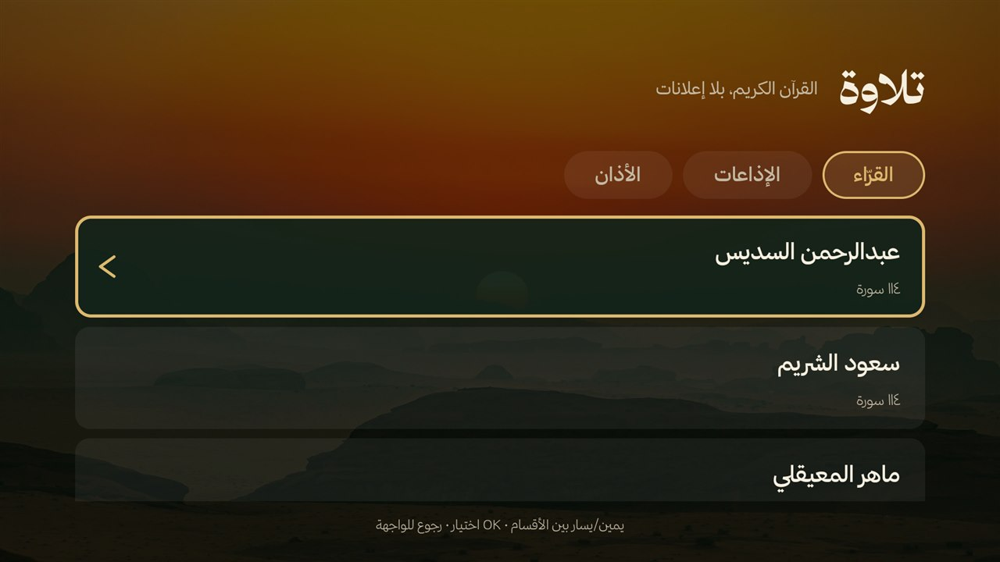
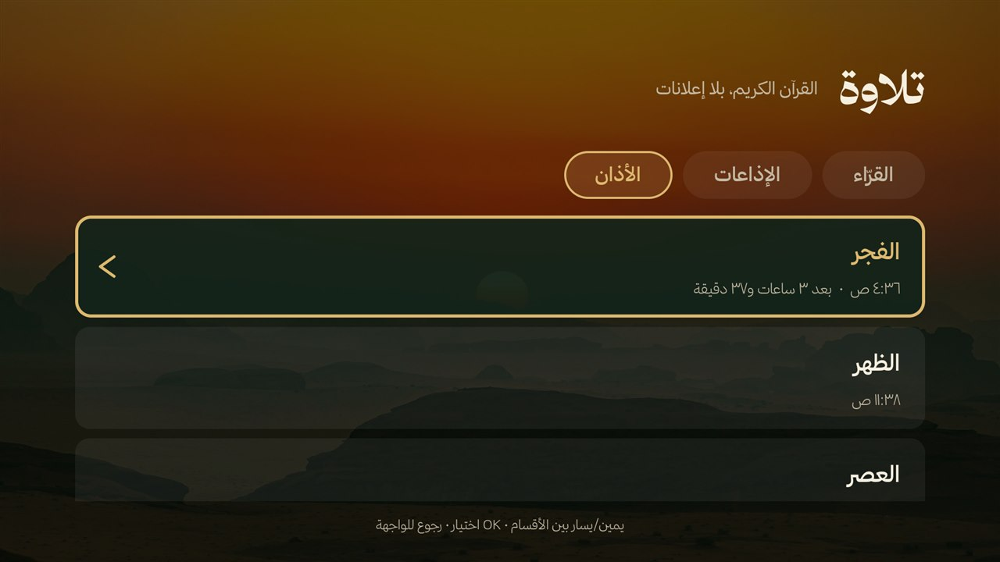
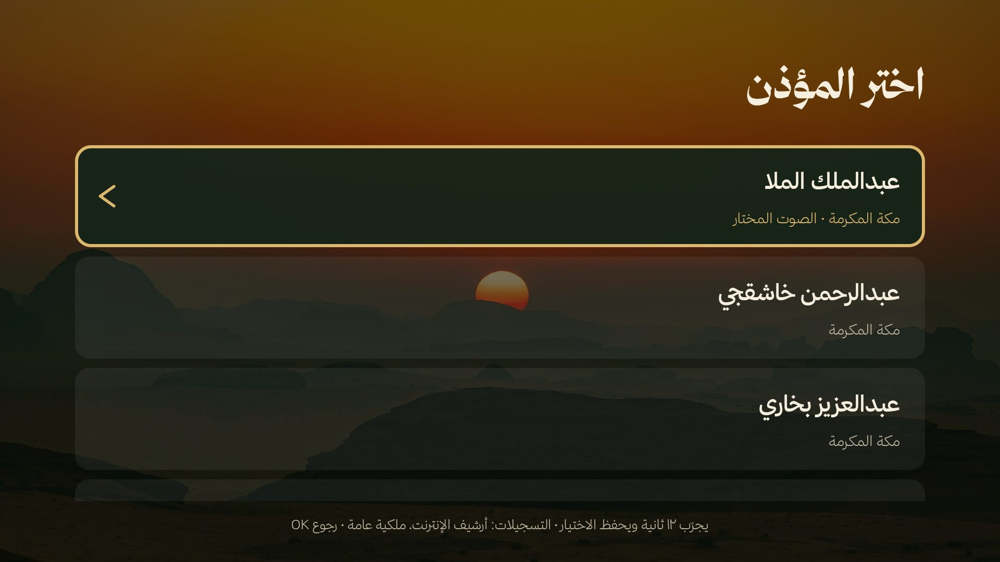
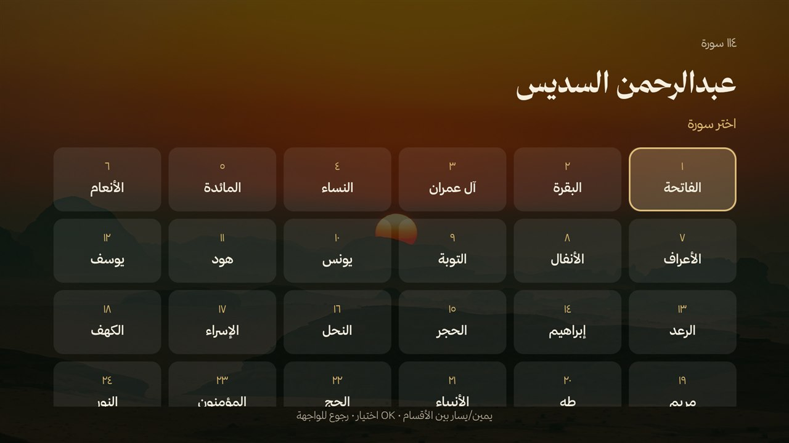
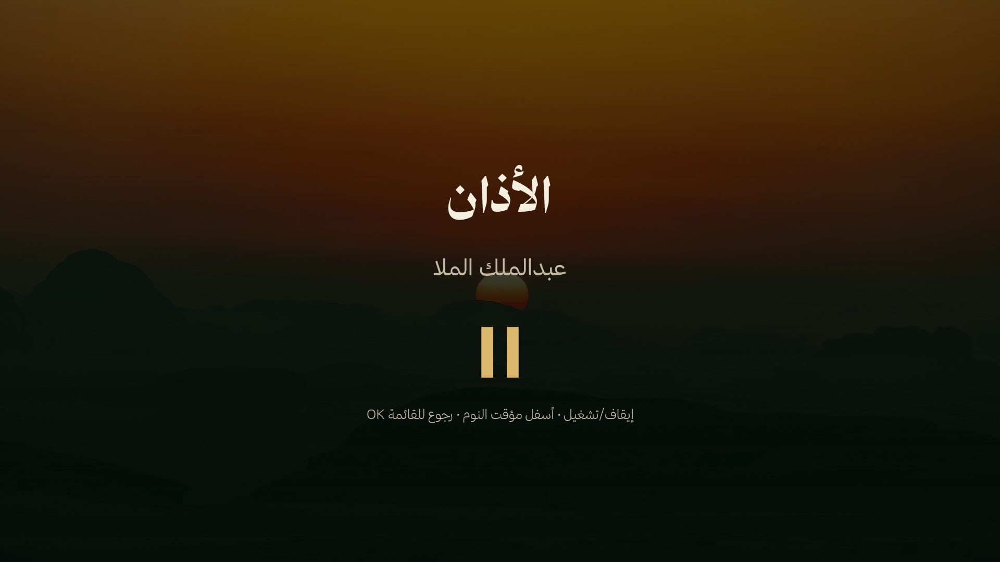
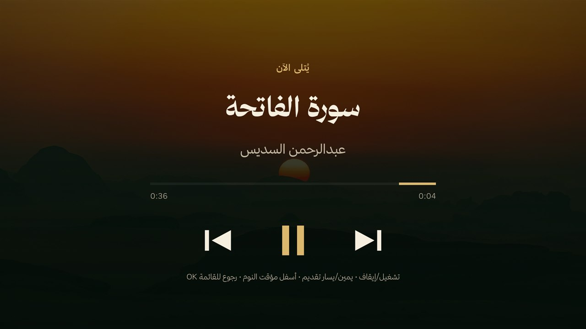

# Tilawah «تلاوة» — the Quran, the radio and the adhan

The «تلاوة» screen is part of the **home app** (`ma.chouitv.home`, which since 4.0 also holds the screensaver and its settings: see «4.0: one app»), not an app of its own: the pill in the top bar
opens it, and it is never listed among the TV's apps. It plays the Quran only — forty reciters' Hafs
murattal (114 surahs each) and live Quran radio — plus the five daily adhans at Umm al-Qura times.
There is no local/USB music, no Spotify or YouTube Music, no account, no ads and no analytics.

Package `ma.chouitv.home` · classes `ma.chouitv.home.tilawah` · label «تلاوة» · minSdk 26, targetSdk 30.

## 4.0: one app

Until 3.x there were two apps: the home screen (`ma.chouitv.home`, with «تلاوة») and the screensaver with its settings
(`ma.chouitv.screensaver`). From 4.0 they are **one package and one APK**, `ma.chouitv.home` (`chouitv-home.apk`, module `android/launcher`;
`android/app` is gone). Only the Java *package name* of the screensaver's sources stayed, so the files did not have to be rewritten:
they live in `android/launcher/src/main/java/ma/chouitv/screensaver/` and still say `package ma.chouitv.screensaver`.

| | until 3.x | 4.0 |
|---|---|---|
| application id(s) | `ma.chouitv.home` + `ma.chouitv.screensaver` | `ma.chouitv.home` |
| release assets | `chouitv-home.apk` + `chouitv-screensaver.apk` | `chouitv-home.apk` (`latest.json` lists only `ma.chouitv.home` in `apks`) |
| settings receiver | `ma.chouitv.screensaver/.SaverReceiver` | `ma.chouitv.home/ma.chouitv.screensaver.SaverReceiver` |
| dream | `ma.chouitv.screensaver/.ScreenDream` | `ma.chouitv.home/ma.chouitv.screensaver.ScreenDream` |
| settings / preview | `ma.chouitv.screensaver/.SettingsActivity`, `.MainActivity` | `ma.chouitv.home/ma.chouitv.screensaver.SettingsActivity`, `…MainActivity` |
| settings provider | `content://ma.chouitv.screensaver.config` | `content://ma.chouitv.home.config` (for the shell only, through DUMP; `content write --uri content://ma.chouitv.home.config/own-in` hands over a photo) |

- The **action names** keep their prefix: `ma.chouitv.screensaver.GET|SET|CITIES|UPDATE|TASKS|PHOTOS|EXPORT|IMPORT`. The home receivers
  (`ma.chouitv.home.*`: `MusicReceiver`, `DockReceiver`, `UpdateReceiver`…) did not change.
- **Signing is unchanged**: one pinned key (`.github/signer-sha256.txt`); `optimize/check-signer.sh chouitv-home.apk` now checks the only APK.
  The two apps used to need a same-key signature for the permissions between them; with one package that guard is between components of the same app (the manifest is the reference for what remains).
- **Moving a TV** from 3.x: `optimize/migrate-to-v4.sh` (see below). `optimize/install.sh all` on a 3.x TV would leave the old screensaver
  app installed beside the new one, so use the migration. `optimize/install.sh app` only installs or updates the app, without switching
  Home or the screensaver.

### Migration note (3.x to 4.0)

`optimize/migrate-to-v4.sh [settings.json] [--yes]`, in this order, so the TV is never without a screensaver or a home screen:

1. the old screensaver's settings are exported (`ma.chouitv.screensaver/.SaverReceiver`, action `ma.chouitv.screensaver.EXPORT`) to
   `optimize/run/settings-before-v4.json`; nothing has changed on the TV yet;
2. 4.0 is installed over the home app (same package, same key); the old screensaver app is still there and still the TV's screensaver;
3. once the new receiver answers, the settings are imported (`IMPORT`, `--es json_b64 … --es apply yes`, all or nothing);
4. the TV's `screensaver_components` and `screensaver_default_component` are pointed at the new dream (only if the TV used ours or none;
   another screensaver is left alone, and a screensaver switch that was off stays off);
5. the result is checked (app installed, receiver answers, dream registered, screensaver and Home not pointing at the old app); only then,
   and after a question (not with `--yes`), `ma.chouitv.screensaver` is uninstalled. Any failed check stops there, with the old app kept.

Not carried over: the photos «صوري» and the tasks (the export does not hold them and they live in the old app's storage);
`optimize/photos.sh` adds photos again. `tests/migrate_v4_test.py` runs the whole route against a stub.

## What is in here

| | |
|---|---|
|  |  |
| The **«القرّاء»** tab — forty reciters, 114 surahs each, and «متابعة التلاوة» when a surah is paused | The **«الأذان»** tab — today's five times at Umm al-Qura, the next one in gold with the time left |
|  |  |
| The **«المؤذن»** list — 21 named recordings; the chosen one in gold with its city | The **«سورة»** grid — the 114 surahs of a reciter, six columns, right to left |
|  |  |
| During an adhan — «الأذان» and the muezzin's name; the skip buttons are gone and the arrows do not seek | A surah — title, reciter, progress and the transport row |

## Where it lives

- The «تلاوة» pill in the home screen's top bar opens `tilawah.MainActivity`.
- The four `tilawah` screens are `exported="false"` and have no `LEANBACK_LAUNCHER` category, so
  Android TV never shows them in the app grid; Back returns to the home screen.
- `res/values/config.xml`: `<bool name="show_listening">false</bool>` takes the pill away.

## Screens and remote

- **The screen**: a tab bar under the title — «القرّاء» (the default), «الإذاعات» and «الأذان» —
  read from the right, like the rest of the app. Left/Right switches section from anywhere on the
  screen; Down (or OK on the tab) enters the list and
  Up from the first row goes back to the tabs. «القرّاء» holds «متابعة التلاوة» when a surah is
  paused, then the forty reciters; «الإذاعات» holds the eleven live stations (and the resume row when
  a station was playing); «الأذان» holds today's five times (the next one in gold with the time left,
  OK plays that adhan now), «الأذان التلقائي» (OK switches it on or off), «المؤذن» (OK opens the 21
  recordings) and «صوت الأذان» (Left/Right set it in steps of 10, 10 % to 100 %, thirty by default, with a bar
  and two seconds of the adhan at the new level; OK does nothing). When exact alarms are not allowed (Android 12+) a row
  «قد يتأخر الأذان دقائق: فعّل المنبّهات الدقيقة» appears under the switch; OK opens the system screen for it. The selected row has a
  solid dark card, a thick gold frame and a gold chevron at the end, so it is visible from the couch.
- **Surah grid**: the 114 surahs in reading order, right to left; OK opens the player.
- **Player**: title, reciter/station, progress, and a transport row. The transport controls stay
  left-to-right (previous, play/pause, next) with universal icons; the rest of the screen is RTL.
  During an adhan it shows «الأذان» and the muezzin's name, hides the previous/next buttons, and
  Left/Right do nothing: an adhan is not seekable.
- **The muezzins**: twenty-one recordings from the public-domain «Azaan of World Mosques» collection —
  seven muezzins of Makkah (عبدالملك الملا، عبدالرحمن خاشقجي، عبدالعزيز بخاري and others), ناجي قزاز
  of Jerusalem, and the mosques and cities: الحرم المكي، المسجد الأقصى، القاهرة، عجمان، أم القيوين،
  عُمان، تونس، ماليزيا، المالديف. The chosen one is in gold with its city under the name; OK picks it
  and plays twelve seconds of it.

| Key | Action |
|---|---|
| OK / Enter | play / pause (in the lists: open / choose) |
| ◀ / ▶ | seek −10 s / +10 s (switches the section on the تلاوة screen) |
| ▼ | sleep timer (30, 60 or 90 minutes; off; stop now) |
| Back | back to the list — playback continues |
| media play/pause, next, previous | work through the media session |

During an adhan, seek and next/previous are ignored, and the hint line says so.

The sleep timer fades the volume out at the end and shows the remaining minutes in gold on the
player. Cancelling it during the fade stops the fade and the sound comes back. Paused (or with another app holding the
sound) for 30 minutes, the player stops by itself; the Wi-Fi lock and the position tick are held only while something plays,
and the place in the surah is saved when it pauses or stops, not every few seconds. On Android 13+ the app asks for the notification permission on first launch; playback
works without it but the media notification is hidden.

## Right to left, and the arrows

The launcher declares `android:supportsRtl="true"`, the four `tilawah` layouts carry
`android:layoutDirection="rtl"` and the home screen (built in code) sets
`View.LAYOUT_DIRECTION_RTL` on its root. So the whole app reads from the right: the title and the
first tab sit on the right, the chevron of a row sits on its left, the surah grid fills from the
right, and the pills, the favourites and the app rows of the home screen do the same.

Android mirrors the D-pad focus search in an RTL layout (there, «right» would move the highlight to
the left), so the screens walk their rows by hand: the home moves the focus to the neighbour on the
side that was pressed, the surah grid does the same for the cells, and the «تلاوة» tabs are
switched by hand as well. In every screen of the app the right arrow moves the highlight to the
right and the left arrow to the left.

## The adhan

- **The times** are Umm al-Qura, computed on the TV with no network: Fajr at 18.5°, Maghrib at
  sunset, Asr at shadow factor 1, Isha 90 minutes after Maghrib (120 in Ramadan, from the
  Umm al-Qura calendar) — an absolute moment, so a Maghrib near midnight at a high latitude gives an Isha after midnight,
  never an hour that has already gone. This is the same arithmetic as the screensaver's page and the same method
  Aladhan calls `method=4`. Once a day the times are quietly replaced by Aladhan's (asked for the city's own date, kept under a key that names the
  city, so a city change the same day asks again; a time written «5:12 (+03)» is read as 5:12), the alarm is set again for
  them, and Isha is always recomputed from Maghrib so Ramadan stays right.
- **The city** is the one picked in the screensaver settings (the app's own `ConfigProvider`, authority `ma.chouitv.home.config`: `lat`, `lon`, `tz`);
  without a picked city, `config.xml`'s `latitude`, `longitude` and `timezone` are used.
- **The switch is off by default.** «الأذان التلقائي» turns it on; the choice is remembered.
- **The alarm** is one `AlarmManager` alarm for the next of the five prayers (action `ADHAN_ALARM`, naming the receiver; the
  shell's `ma.chouitv.home.ADHAN` is «adhan now» and reaches `MusicReceiver` only). It is exact when Android allows it; from
  Android 12 without the exact-alarm permission the system may deliver it minutes late, and the adhan tab says so. It is put
  back when the adhan has played, after a reboot, after a clock or timezone change, after an update and when Aladhan's times
  arrive. The same prayer's adhan never plays twice (judged by the prayer's own time, so a preview of a muezzin five
  minutes before does not silence the real one); a preview that is playing gives way to the real adhan.
- **Only while the TV is on.** An alarm that arrives in standby is skipped, not played late: there is
  no catch-up after a reboot or a missed prayer, and an adhan that is playing stops when the screen
  goes off.
- **Its own volume.** The adhan plays at 30% of the TV's maximum (`صوت الأذان` in the adhan tab: Left/Right, 10–100% in
  steps of 10; `optimize/music.sh adhan volume 60`), and the volume the TV had comes back when the adhan ends.
- **During an adhan** a playing surah (or station) pauses, the adhan plays, and the surah resumes
  where it stopped. «متابعة التلاوة» keeps pointing at the surah, never at the adhan.
- **The recordings** are twenty-one adhans (muezzins and mosques) from the «Azaan of World Mosques»
  collection on Archive.org, released under the **Public Domain Mark 1.0**
  (<https://archive.org/details/azaan-of-world-mosques_202608>) — free to redistribute, no attribution
  required; the source is credited in the app's adhan screen and here. The table of names and URLs is
  in `Adhan.java`. Each one is kept in `getCacheDir()/adhan/adhan-N.mp3` the first time it is needed
  — the chosen one first, fetched when the alarm is set (not only when the screen opens), the rest lazily, a failed one
  skipped, at most one round a day — so an adhan plays from the saved copy, with the connection down. A file is kept only if
  its length is the server's Content-Length. A stream that drops falls back to the saved copy.
- **«أذان من ملفي»** is the person's own recording (`OwnAdhan.java`), for a muezzin whose recordings are not
  free to redistribute, so none is ever bundled: `optimize/music.sh adhan add FILE` makes a mono AAC of about
  48 kbps, at most 5 minutes, on the computer (ffmpeg), uploads it through `OwnAdhanProvider` (`content write`,
  shell only, write-only) and `MusicReceiver ADHAN_OWN` checks and keeps it as `files/adhan-own.m4a`: one file, a new
  one replaces it. It stays in the app's private folder, is never read out or sent, and plays straight from
  there (no download, no retry from the network). When it exists the adhan screen's first row is «أذان من ملفي»
  (voice number 0); `adhan voice 1-21` goes back to ours and `adhan own-clear` removes it.
- The switch, the muezzin and the volume live in the app's preferences (`tilawah`); the alarm needs
  `SCHEDULE_EXACT_ALARM` and the volume needs `MODIFY_AUDIO_SETTINGS` (both are ordinary permissions;
  the app falls back to an inexact alarm if exact alarms are refused).

## Control it over ADB

`optimize/music.sh` wraps the app's shell-only broadcast receiver (the receiver requires
`android.permission.DUMP`, so only the ADB shell can send it — other apps cannot):

```bash
optimize/music.sh status
optimize/music.sh reciters                 # ids for the next command
optimize/music.sh stations                 # indices for the next command
optimize/music.sh surah sudais 1           # Al-Fatiha by Sudais
optimize/music.sh radio 0                  # Saudi Quran Radio
optimize/music.sh pause | resume | toggle | next | prev | stop
optimize/music.sh seek -10                 # 10 seconds back
optimize/music.sh sleep 30                 # 0 cancels
optimize/music.sh adhan                    # on/off, voice, next time, last played
optimize/music.sh adhan now 3              # play voice 3 right now
optimize/music.sh adhan off | on
optimize/music.sh adhan voice 7            # the recording used at the prayer times
optimize/music.sh adhan volume 60          # its own volume, 10-100
optimize/music.sh adhan add my-adhan.mp3   # the person's own recording (ffmpeg here makes it small); `adhan voice own`, `adhan own-clear`
```

`status` prints one line:

```
playing=1|source=surah|reciter=sudais|reciter_name=عبدالرحمن السديس|surah=1|surah_name=الفاتحة|station=-1|station_name=|pos=12400|dur=36075|sleep=0|adhan=on|voice=1|adhan_volume=30|adhan_exact=1|adhan_next=1761000000000|adhan_next_name=المغرب|adhan_next_clock=17:42|adhan_last=0|error=
```

The raw broadcasts are the same actions:

```bash
adb shell am broadcast -n ma.chouitv.home/.tilawah.MusicReceiver -a ma.chouitv.home.GET_PLAYER
adb shell am broadcast -n ma.chouitv.home/.tilawah.MusicReceiver -a ma.chouitv.home.PLAY_SURAH --es reciter sudais --ei surah 1
adb shell am broadcast -n ma.chouitv.home/.tilawah.MusicReceiver -a ma.chouitv.home.PLAY_RADIO --ei station 0
adb shell am broadcast -n ma.chouitv.home/.tilawah.MusicReceiver -a ma.chouitv.home.ADHAN --ei voice 3
```

## Catalog

The catalog is generated and committed, so the app builds and starts offline:

```bash
python3 .github/tools/fetch_quran.py           # regenerate the three JSON files
python3 .github/tools/fetch_quran.py --check   # ranged GET of every stream URL
```

- **Reciters** are forty curated Hafs murattal entries from [mp3quran.net](https://mp3quran.net);
  the app builds `server + 001.mp3 … 114.mp3` from the server field.
- **Surahs** come from [api.alquran.cloud](https://alquran.cloud); names are stripped of the
  «سُورَةُ» prefix, vowel marks and tatweel.
- **Stations** are eleven live streams from mp3quran/qurango.net, with the Saudi Quran Radio first.
- Streams move or go quiet; the `--check` run verifies one kilobyte of each URL. At the time of
  writing all 51 URLs answered with `audio/mpeg`. A station that fails may be temporarily down;
  the app retries and reports it.

The assets live in `android/launcher/src/main/assets/quran/` (`reciters.json`, `stations.json`,
`surahs.json`). `tests/tilawah_test.py` checks the catalog, the adhan, the cleartext
scope and the manifest.

## Network and privacy

- Runtime requests are the audio streams and their redirects, the adhan recordings
  (`archive.org`), and one Aladhan call a day (`api.aladhan.com`, method 4). There is no account,
  upload, analytics or ad SDK.
- `res/xml/network_security_config.xml` sets `cleartextTrafficPermitted="false"` globally. The Saudi
  Quran Radio (`stream.radiojar.com`) redirects to its CDN over `http://n0X.radiojar.com`; cleartext
  is allowed only for `radiojar.com` and its subdomains. Nothing else may use HTTP.
- Permissions: internet, network/Wi-Fi state (Wi-Fi lock), wake lock, foreground media playback,
  notifications, boot completed (the adhan alarm), exact alarms, and modify audio settings (the
  adhan's own volume). There is no storage permission and no access to local media.

## Build and test

```bash
# with JDK 17 and an Android SDK with platform 34
gradle -p android :launcher:assembleRelease
python3 tests/tilawah_test.py
```

Releases are made by hand since 3.175 (the workflow in `.github/workflows/android.yml` only runs on the branches `master` and `next`, and the
repository is on `main`, so a push builds nothing): build the app with `GITHUB_RUN_NUMBER=N` (N above the last release; `gradle -p android :launcher:assembleRelease`), make a release `v3.N` holding
`chouitv-home.apk` only (`gh release create v3.N …`), then put the new version, its URL and its SHA-256 in
`latest.json` on `main`: that file is what the TVs, `optimize/install.sh` and ChouiTV Installer read. `releases/latest/download/<file>` always gives the
newest numbered release. Always run `optimize/check-signer.sh chouitv-home.apk` before publishing (see Signing below).

## Signing

Every release is signed with **one key**; the app already on the TVs accepts an update only if it is signed with the same key, so losing it, or
signing with another one, ends the updates for good (the only way out is uninstalling, which erases the TV's settings). Its SHA-256 is pinned in
`.github/signer-sha256.txt` (`af6154f7…f242`).

- The key is the one Android Studio / Gradle made as `~/.android/debug.keystore` when the project was first built, now also kept as
  `~/chouitv-signing/chouitv.p12` (alias `urtv`, password in `password.txt` next to it, both mode 600). It is **not** in this repository and **not**
  in the GitHub secrets (an earlier comment said so; it was wrong).
- A release build needs `ANDROID_KEYSTORE=<the .p12>` and `ANDROID_KEYSTORE_PASSWORD`; without them Gradle stops with an error, instead of
  silently signing with a debug key that no TV trusts.
- `optimize/check-signer.sh <apk>…` compares the APKs with the pinned fingerprint; run it before every release.
- **Keep two offline copies of the `.p12` and of its password, in two places** (a USB stick and a password manager, for example). If the file is lost
  there is no recovery: Android would not accept an update signed with a new key.

## The signed version file (3.180)

`latest.json` is read from GitHub, so anyone who got into the repository could point the TVs at other files. Since 3.180 the TVs, and ChouiTV
Installer 1.5, believe a `latest.json` only if `latest.json.sig` (next to it on `main`) is the owner's ECDSA P-256 signature of exactly its bytes.

- The private key is `~/chouitv-signing/manifest-key.pem` (mode 600, **not** in the repository). The public half is `optimize/manifest-pub.b64`
  and is compiled into the apps (`ManifestTrust.PUBLIC_KEY`, in the launcher and in the Installer). **Keep two offline copies of the `.pem`** like the APK key:
  without it no new version can be announced, and changing the key means shipping an update signed with the old one that carries the new one.
- Release order: build and make the release assets, write the new `latest.json`, run `optimize/sign-manifest.sh` (it signs and checks against
  the public key), then commit `latest.json` **and** `latest.json.sig` in the same push.
- A TV on 3.179 or older does not check the signature; from 3.180 on, a missing or wrong `.sig` means «no update» (the cause shows in `saver.sh update`).

## Known limits

- Live streams depend on third parties; a station can be down, move, or be blocked on some networks.
- No downloads/offline mode for surahs, by design (the adhan recordings are cached).
- The adhan times are Umm al-Qura; a TV outside Saudi Arabia gets that method for its own
  coordinates, which is the project's choice, not a local authority's calendar.
- The UI is Arabic/RTL; the transport buttons are intentionally LTR so the previous/next arrows match
  every other player.

## Keys and the adhan (3.169)

- The adhan tab starts with the switch; off, nothing else is listed; on, today's prayers (OK opens a prayer's own options) and the muezzin/volume follow.
- Any key on a screen of the home app or of «الاستماع», and the end of the screensaver, stops the adhan of a prayer while it rings (`AdhanStop`, `AdhanStopReceiver` with the signature permission `ma.chouitv.home.permission.STOP_ADHAN`). Volume keys keep their job; a trial of a muezzin is not stopped by keys. Another app in front (YouTube…) cannot be listened to by ours: its notification has a stop button.
- Left/right change the section from the tab bar and from the adhan list (the focus then goes to the tab bar); in the grids of reciters and stations they move between the cards.
